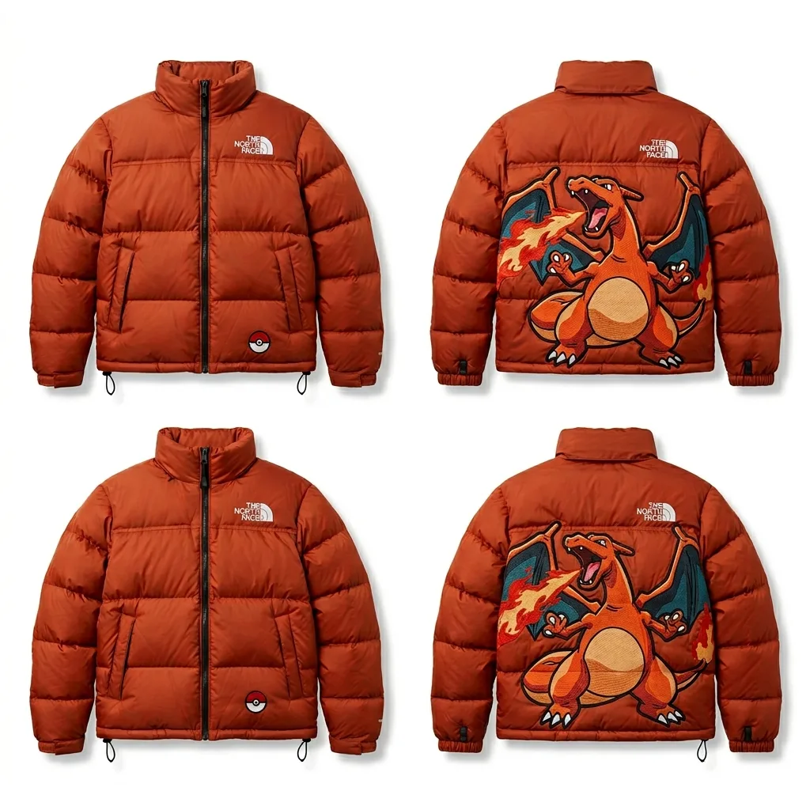

# High-end editorial product shot of a custom The North

[← Back to the collection](../../README.md) · Category: [Product & Brand](../../gallery/product-brand.md) · Model: `Vinano Image Pro` · ID: `vn-00302`

<a href="https://vinano.ai?utm_source=github&utm_medium=readme&utm_campaign=awesome-image-video-prompts-updating&utm_content=prompt-page-image"></a>

<sub>Preview generated with <a href="https://vinano.ai?utm_source=github&utm_medium=readme&utm_campaign=awesome-image-video-prompts-updating&utm_content=prompt-page-caption">vinano.ai</a></sub>

## Prompt

```text
High-end editorial product shot of a custom The North Face Nuptse 700 puffer jacket inspired by [POKEMON].
The jacket’s primary colorway automatically derives from [POKEMON]’s dominant palette (main body color as base tone, secondary accents used sparingly for contrast), translated into premium, wearable hues — never cartoonish, always fashion-forward.
A large-scale embroidered [POKEMON] artwork dominates the back panel, adapted to the jacket’s quilted structure.
Embroidery style reflects [POKEMON]’s core identity:

aggressive Pokémon → bold stitch density, sharp contours
elegant or mystical Pokémon → flowing lines, layered thread gradients

armored or mechanical Pokémon → heavy, structured embroidery tactile depth

The front of the jacket remains minimal and restrained:
clean TNF logo, subtle Poké Ball patch, no additional graphics.

Material realism is critical: visible fabric sheen, natural puff volume, precise seam alignment, embroidery threads sitting slightly raised from the nylon surface.

Shot in a Japanese fashion magazine product layout, pure white background.
Front and back views presented together, jacket floating upright, perfectly centered.
Lighting is clean, studio-soft controlled contrast to emphasize texture and craftsmanship.

Mood: luxury streetwear meets collectible archive piece.
No model. No props. No distractions.
Ultra-sharp focus, high resolution, editorial polish, timeless design.

Maintain consistent colour harmony and crisp focus across the whole frame.
```

## Try it on vinano.ai

1. Copy the prompt above.
2. Open **[vinano.ai](https://vinano.ai?utm_source=github&utm_medium=readme&utm_campaign=awesome-image-video-prompts-updating&utm_content=prompt-page-try)**, paste it into the image generator and pick a model.
3. Swap any placeholders (brand, product, city, person…) for your own details, then generate.

More prompts like this: [Product & Brand gallery](../../gallery/product-brand.md) · [all categories](../../README.md#contents)
