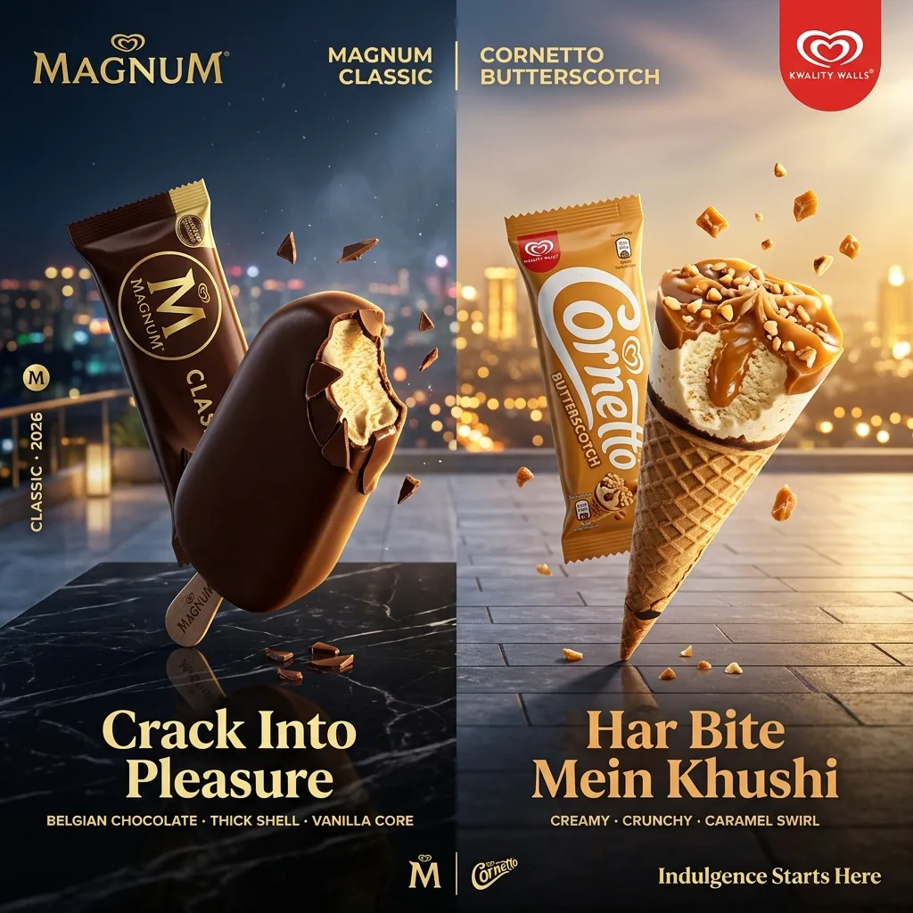

# FMCG ice cream commercial ad poster

[← Back to the collection](../../README.md) · Category: [Product & Brand](../../gallery/product-brand.md) · Model: `Vinano Image Pro` · ID: `vn-00312`

<a href="https://vinano.ai?utm_source=github&utm_medium=readme&utm_campaign=awesome-image-video-prompts-updating&utm_content=prompt-page-image"></a>

<sub>Preview generated with <a href="https://vinano.ai?utm_source=github&utm_medium=readme&utm_campaign=awesome-image-video-prompts-updating&utm_content=prompt-page-caption">vinano.ai</a></sub>

## Prompt

```text
Hyper-realistic professional FMCG ice cream commercial ad poster. Magnum Classic in dark chocolate brown featuring dual composition: one sealed Magnum wrapper and one bitten ice cream bar, arranged on a polished black marble surface.

Background: a luxurious night-time rooftop setting overlooking a blurred city skyline golden lights bokeh, evoking exclusivity and indulgence.
Cool night air subtle drifting mist.

The sealed pack positioned slightly behind at a refined angle, gold branding catching ambient city light.
The opened Magnum bar in front a bite taken out, chocolate shell cracking dramatically revealing creamy vanilla core.

The product hyper-detailed — sharp chocolate fracture edges catching warm golden highlights, molten interior texture visible, slight melting at edges, reflection visible on marble surface below.

Floating micro chocolate shards suspended mid-air.

Composition: bitten bar dominates foreground, packaging secondary, cinematic negative space blending into city lights.

Typography:
top left — Magnum logo gold.
center — “MAGNUM CLASSIC”.
bottom left — “Crack Into Pleasure”.
below — “BELGIAN CHOCOLATE · THICK SHELL · VANILLA CORE”.
bottom right — “Indulgence Starts Here”.
thin separator.
bottom center — “ m
left vertical — “CLASSIC · 2026”.

Lighting: mixed lighting — soft city glow + warm rim light enhancing chocolate gloss, deep cinematic contrast.

Mood: sensual, luxurious, late-night indulgence.

Shot on ARRI Alexa Mini LF, 100mm macro, shallow DOF, HDR, ultra true-to-life photorealistic, cinematic FMCG poster, 4:5 portrait.

Hyper-realistic professional FMCG ice cream commercial ad poster. Kwality Walls Cornetto Butterscotch featuring dual composition: one sealed Cornetto pack and one open cone a bite taken out, arranged on a slightly reflective street-side surface.

Background: vibrant Indian summer street scene during golden hour, soft-focus silhouettes of people, colorful stalls, and warm festive tones.
Warm sunlight haze floating dust particles.

The sealed pack positioned upright behind, branding clearly visible.
The open cone in front a bite exposing creamy caramel core and crunchy layers.

The product hyper-detailed — crisp waffle cone, glossy caramel ribbons catching sunlight, slight melting edges, reflection visible below.

Floating caramel bits and nut fragments mid-air.

Composition: dynamic and lively, cone hero foreground, background adds cultural warmth without distraction.

Typography:
top left — Kwality Walls logo.
center — “CORNETTO BUTTERSCOTCH”.
bottom left — “Har Bite Mein Khushi”.
below — “CREAMY · CRUNCHY · CARAMEL SWIRL”.
bottom right — “Taste the Joy”.
thin separator.
bottom center — “
left vertical — “CORNETTO · 2026”.

Lighting: natural golden sunlight, warm highlights, soft shadows, slight lens flare.

Mood: joyful, nostalgic, everyday happiness.

Shot on ARRI Alexa Mini LF, 50mm, shallow DOF, HDR, vibrant FMCG ad poster.

Aim for an editorial, design-driven look with deliberate negative space.
```

## Try it on vinano.ai

1. Copy the prompt above.
2. Open **[vinano.ai](https://vinano.ai?utm_source=github&utm_medium=readme&utm_campaign=awesome-image-video-prompts-updating&utm_content=prompt-page-try)**, paste it into the image generator and pick a model.
3. Swap any placeholders (brand, product, city, person…) for your own details, then generate.

More prompts like this: [Product & Brand gallery](../../gallery/product-brand.md) · [all categories](../../README.md#contents)
