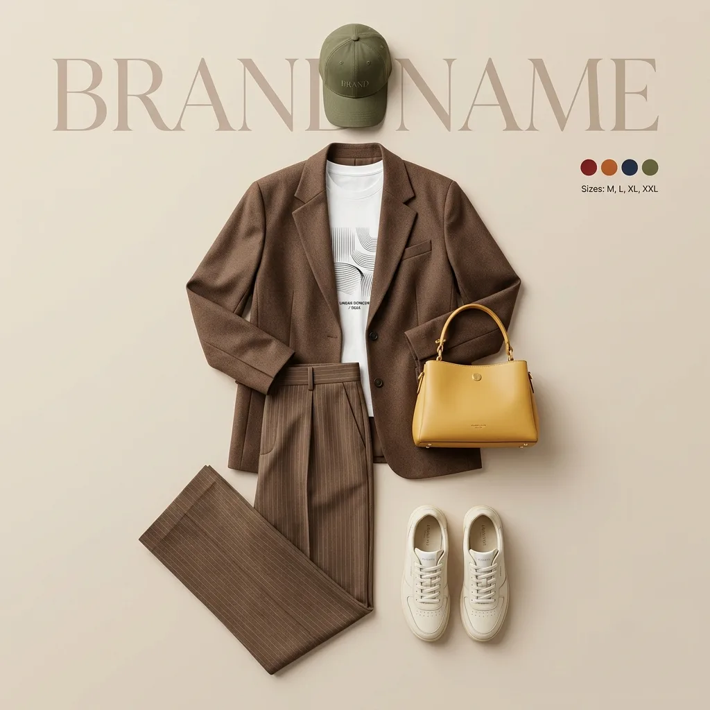

# Premium fashion catalog flat lay on a clean soft

[← Back to the collection](../../README.md) · Category: [Product & Brand](../../gallery/product-brand.md) · Model: `Vinano Image Pro` · ID: `vn-00321`

<a href="https://vinano.ai?utm_source=github&utm_medium=readme&utm_campaign=awesome-image-video-prompts-updating&utm_content=prompt-page-image"></a>

<sub>Preview generated with <a href="https://vinano.ai?utm_source=github&utm_medium=readme&utm_campaign=awesome-image-video-prompts-updating&utm_content=prompt-page-caption">vinano.ai</a></sub>

## Prompt

```text
Create a premium fashion catalog flat lay on a clean soft beige studio background.
Only show the outfit items, arranged neatly as if for an ecommerce product display.

Items included: • Brown oversized blazer
• White graphic t-shirt
• Brown pinstripe wide-leg trousers
• Olive green cap
• Cream sneakers
• Yellow designer handbag

Arrange the clothing in a clean aesthetic flat-lay composition so it looks like the outfit is worn but without any person or mannequin. Each item must be perfectly isolated and clearly visible realistic folds and shadows. The layout should look professional and balanced like a luxury fashion brand product catalog.

Lighting: soft studio lighting, minimal shadows, ultra sharp details, high fashion editorial style, 4K quality.

Add a large stylish bold text in the background behind the outfit: BRAND NAME

Typography should be modern, elegant and slightly faded so it looks like a branding element of the catalog.

Add a small product info section on one side: Sizes: M, L, XL, XXL

Next to it place small circular color indicators showing available colors: Red, Orange, Blue, Green

Important requirements: • No person
• No character
• No mannequin
• Only clothes and accessories
• Clean catalog layout
• Ultra detailed fabric texture
• Professional ecommerce product presentation

Aim for an editorial, design-driven look with deliberate negative space.
```

## Try it on vinano.ai

1. Copy the prompt above.
2. Open **[vinano.ai](https://vinano.ai?utm_source=github&utm_medium=readme&utm_campaign=awesome-image-video-prompts-updating&utm_content=prompt-page-try)**, paste it into the image generator and pick a model.
3. Swap any placeholders (brand, product, city, person…) for your own details, then generate.

More prompts like this: [Product & Brand gallery](../../gallery/product-brand.md) · [all categories](../../README.md#contents)
