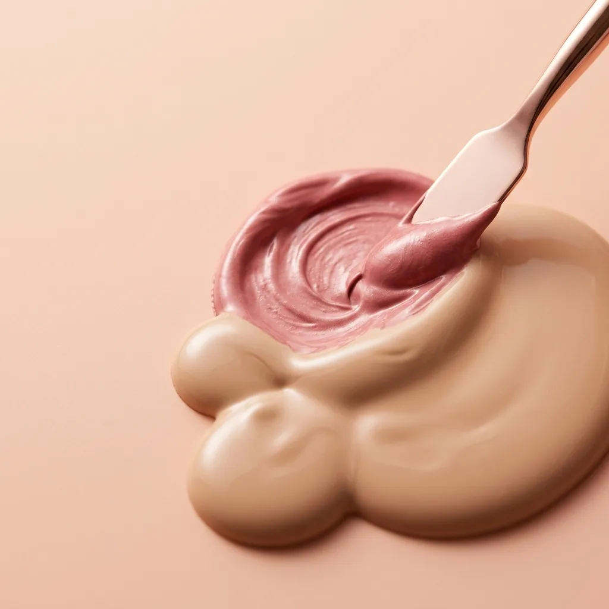

# Prompt type

[← Back to the collection](../../README.md) · Category: [Product & Brand](../../gallery/product-brand.md) · Model: `Vinano Image Pro` · ID: `vn-00324`

<a href="https://vinano.ai?utm_source=github&utm_medium=readme&utm_campaign=awesome-image-video-prompts-updating&utm_content=prompt-page-image"></a>

<sub>Preview generated with <a href="https://vinano.ai?utm_source=github&utm_medium=readme&utm_campaign=awesome-image-video-prompts-updating&utm_content=prompt-page-caption">vinano.ai</a></sub>

## Prompt

```text
{
  "prompt_type": "viral_makeup_product_visual",
  "scene": "ASMR-style product texture showcase",
  "products": ["cream blush being swirled spatula",
    "foundation drops merging smoothly"],
  "details": {
    "texture_focus": "creamy, buttery, ultra-smooth consistency",
    "lighting": "soft diffused lighting",
    "color_theme": "nude, peach, soft rose"
  },
  "mood": "satisfying, calming, premium",
  "camera": "extreme macro shot",
  "background": "clean pastel surface"
}

Aim for an editorial, design-driven look with deliberate negative space.
```

## Try it on vinano.ai

1. Copy the prompt above.
2. Open **[vinano.ai](https://vinano.ai?utm_source=github&utm_medium=readme&utm_campaign=awesome-image-video-prompts-updating&utm_content=prompt-page-try)**, paste it into the image generator and pick a model.
3. Swap any placeholders (brand, product, city, person…) for your own details, then generate.

More prompts like this: [Product & Brand gallery](../../gallery/product-brand.md) · [all categories](../../README.md#contents)
