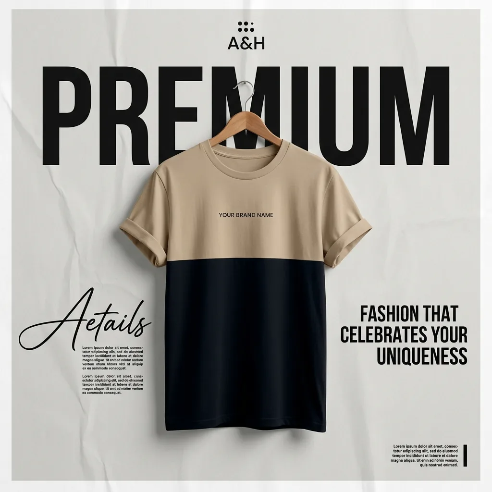

# High-end refined minimalist fashion advertisement poster

[← Back to the collection](../../README.md) · Category: [Product & Brand](../../gallery/product-brand.md) · Model: `Vinano Image Pro` · ID: `vn-00344`

<a href="https://vinano.ai?utm_source=github&utm_medium=readme&utm_campaign=awesome-image-video-prompts-updating&utm_content=prompt-page-image"></a>

<sub>Preview generated with <a href="https://vinano.ai?utm_source=github&utm_medium=readme&utm_campaign=awesome-image-video-prompts-updating&utm_content=prompt-page-caption">vinano.ai</a></sub>

## Prompt

```text
Create a high-end refined minimalist fashion advertisement poster.
Background: light grey wrinkled paper poster texture editorial magazine layout.
At the top center place a small brand label “A&H” minimal dots style logo above it.
Behind the product place a huge bold word “PREMIUM” in black, very large sans-serif font, spanning almost the entire width of the poster.
Center of the poster:
A two-tone t-shirt hanging on a wooden hanger.
Top half color beige/tan, bottom half deep black.
Short sleeves slightly folded.
Clean premium cotton texture.
On the chest of the shirt place the small text “YOUR BRAND NAME” in simple minimal font.
Left side design area:
Stylish script word “Aetails” (signature style starting A) replacing “Details”.
Under it small editorial paragraph blocks (magazine layout filler text).
Right side:
Editorial typography block the phrase
“FASHION THAT CELEBRATES YOUR UNIQUENESS”
in bold modern sans-serif.
Bottom right small editorial text block similar to fashion magazine layout.
Important rules: • Do NOT add any website URLs
• Do NOT add social media icons
• Do NOT add barcodes
• Do NOT add any random or unrecognizable text
• Brand name must be “A&H”
• Keep same colors, same layout, same typography style, same font weight, same font sizes, same composition
• clean luxury fashion ad aesthetic
• studio lighting, ultra sharp, true-to-life photorealistic, 4K fashion poster design

Keep edges clean and the overall composition balanced for a polished, gallery-ready result.
```

## Try it on vinano.ai

1. Copy the prompt above.
2. Open **[vinano.ai](https://vinano.ai?utm_source=github&utm_medium=readme&utm_campaign=awesome-image-video-prompts-updating&utm_content=prompt-page-try)**, paste it into the image generator and pick a model.
3. Swap any placeholders (brand, product, city, person…) for your own details, then generate.

More prompts like this: [Product & Brand gallery](../../gallery/product-brand.md) · [all categories](../../README.md#contents)
