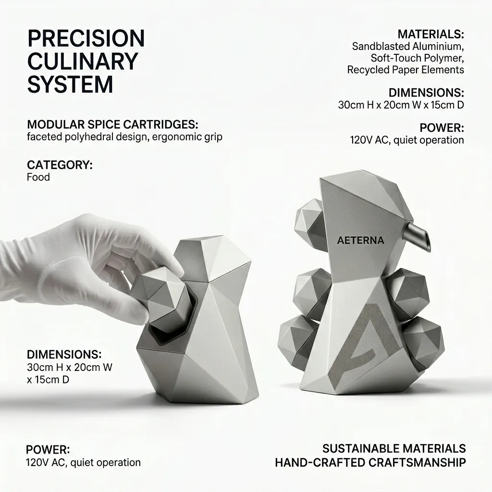

# Product & Brand prompt #381

[← Back to the collection](../../README.md) · Category: [Product & Brand](../../gallery/product-brand.md) · Model: `Vinano Image Pro` · ID: `vn-00381`

<a href="https://vinano.ai?utm_source=github&utm_medium=readme&utm_campaign=awesome-image-video-prompts-updating&utm_content=prompt-page-image"></a>

<sub>Preview generated with <a href="https://vinano.ai?utm_source=github&utm_medium=readme&utm_campaign=awesome-image-video-prompts-updating&utm_content=prompt-page-caption">vinano.ai</a></sub>

## Prompt

```text
[BRAND NAME]: The core identity.

[CATEGORY]: Clothing / Food / Automotive / Lifestyle.

Goal: Generate a premium industrial design concept on a PURE WHITE background.

1. INNOVATION & OBJECT

- Select one mundane functional object from [CATEGORY].

- Redesign it unconventional, architectural, or origami-inspired geometry.

- The object must look like a high-end designer invention, not a standard product.

2. UNIFIED COMPOSITION

- Environment: A seamless, pure white studio background a flat white floor.

- Interaction: A human hand (natural texture) is shown the object in the foreground, demonstrating its unique ergonomics.

- Static Display: Right next to the hand, the same object is placed in a static, perfect pose to show its full silhouette and branding.

- Shadows: Soft, realistic grey drop shadows on the white floor to provide depth and ground the objects.

3. BRANDING & TEXT

- Identity: Apply the "[BRAND NAME]" logo in a high-contrast dark color (Black or Navy) directly onto the object's surface.

- Technical Detail: Add small, elegant blocks of justified "specification text" in the white negative space around the objects for an editorial look.

- Pattern: Use a subtle, oversized abstract fragment of the brand's logo as a texture on the object's material.

4. MATERIALS & FINISH

- premium-quality matte materials only: heavy-duty recycled paper, sandblasted metal, or soft-touch polymer.

- Sharp architectural lines and clean, premium craftsmanship.

Preserve realistic proportions and depth for a confident, professional finish.
```

## Try it on vinano.ai

1. Copy the prompt above.
2. Open **[vinano.ai](https://vinano.ai?utm_source=github&utm_medium=readme&utm_campaign=awesome-image-video-prompts-updating&utm_content=prompt-page-try)**, paste it into the image generator and pick a model.
3. Swap any placeholders (brand, product, city, person…) for your own details, then generate.

More prompts like this: [Product & Brand gallery](../../gallery/product-brand.md) · [all categories](../../README.md#contents)
