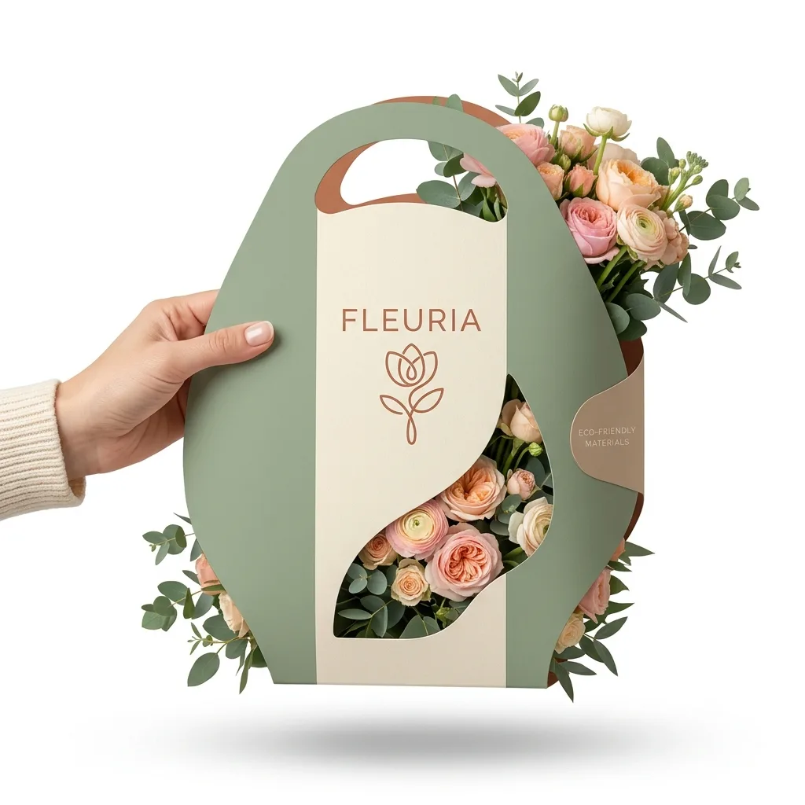

# Refined minimalist branded flower packaging design for brand

[← Back to the collection](../../README.md) · Category: [Product & Brand](../../gallery/product-brand.md) · Model: `Vinano Image Pro` · ID: `vn-00434`

<a href="https://vinano.ai?utm_source=github&utm_medium=readme&utm_campaign=awesome-image-video-prompts-updating&utm_content=prompt-page-image"></a>

<sub>Preview generated with <a href="https://vinano.ai?utm_source=github&utm_medium=readme&utm_campaign=awesome-image-video-prompts-updating&utm_content=prompt-page-caption">vinano.ai</a></sub>

## Prompt

```text
refined minimalist branded flower packaging design for [brand], eco-friendly cardboard sleeve integrated handle, sculptural curved silhouette wrapping naturally around a fresh bouquet, packaging fully designed the official brand color palette, matte surface the brand logo cleanly centered on the front panel, precision die-cut window integrated into the design allowing flowers to subtly emerge, cohesive color blocking aligned brand identity, modern premium branding aesthetic, smooth paper texture, refined structural details, hand holding the package naturally, studio product photography, centered composition, pure white background, soft realistic contact shadow beneath, high-end packaging mockup, ultra-detailed, 1:1 aspect ratio. Aim for an editorial, design-driven look with deliberate negative space.
```

## Try it on vinano.ai

1. Copy the prompt above.
2. Open **[vinano.ai](https://vinano.ai?utm_source=github&utm_medium=readme&utm_campaign=awesome-image-video-prompts-updating&utm_content=prompt-page-try)**, paste it into the image generator and pick a model.
3. Swap any placeholders (brand, product, city, person…) for your own details, then generate.

More prompts like this: [Product & Brand gallery](../../gallery/product-brand.md) · [all categories](../../README.md#contents)
