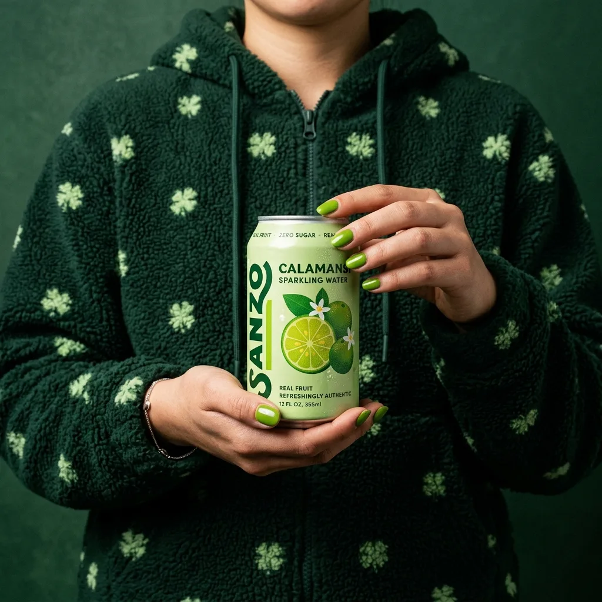

# True-to-life photorealistic product shot of a person holding

[← Back to the collection](../../README.md) · Category: [Product & Brand](../../gallery/product-brand.md) · Model: `Vinano Image Pro` · ID: `vn-00444`

<a href="https://vinano.ai?utm_source=github&utm_medium=readme&utm_campaign=awesome-image-video-prompts-updating&utm_content=prompt-page-image"></a>

<sub>Preview generated with <a href="https://vinano.ai?utm_source=github&utm_medium=readme&utm_campaign=awesome-image-video-prompts-updating&utm_content=prompt-page-caption">vinano.ai</a></sub>

## Prompt

```text
A true-to-life photorealistic product shot of a person holding a slim, light green can of Sanzo Calamansi Sparkling Water. The person is wearing a dark green, fuzzy fleece zip-up hoodie patterned light green four-leaf clovers. Both hands are holding the can centrally in front of their torso, displaying perfectly manicured nails painted in a glossy green polish. The can features an illustration of a sliced calamansi lime green leaves. The background is a solid, moody dark green, creating a striking monochromatic green aesthetic. Soft, professional studio lighting, highly detailed. Aim for an editorial, design-driven look with deliberate negative space.
```

## Try it on vinano.ai

1. Copy the prompt above.
2. Open **[vinano.ai](https://vinano.ai?utm_source=github&utm_medium=readme&utm_campaign=awesome-image-video-prompts-updating&utm_content=prompt-page-try)**, paste it into the image generator and pick a model.
3. Swap any placeholders (brand, product, city, person…) for your own details, then generate.

More prompts like this: [Product & Brand gallery](../../gallery/product-brand.md) · [all categories](../../README.md#contents)
