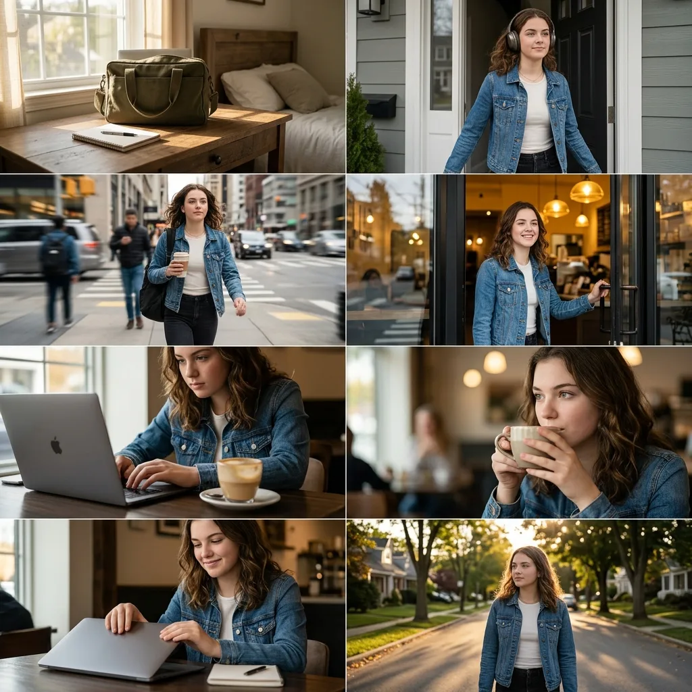

# 8-photo storytelling collage featuring the same girl throughout

[← Back to the collection](../../README.md) · Category: [Product & Brand](../../gallery/product-brand.md) · Model: `Vinano Image Pro` · ID: `vn-00448`

<a href="https://vinano.ai?utm_source=github&utm_medium=readme&utm_campaign=awesome-image-video-prompts-updating&utm_content=prompt-page-image"></a>

<sub>Preview generated with <a href="https://vinano.ai?utm_source=github&utm_medium=readme&utm_campaign=awesome-image-video-prompts-updating&utm_content=prompt-page-caption">vinano.ai</a></sub>

## Prompt

```text
cinematic 8-photo storytelling collage featuring the same girl throughout the journey.
Frame 1: Bedroom desk — laptop bag packed, morning light.
Frame 2: Leaving home — headphones on, confident walk.
Frame 3: City sidewalk — coffee aroma vibes, motion blur.
Frame 4: Entering café — warm interiors, soft smiles.
Frame 5: Laptop open — deep focus, typing.
Frame 6: Coffee sip — thoughtful pause.
Frame 7: Closing laptop — productive satisfaction.
Frame 8: Walking back home — golden hour calm.
Editorial lifestyle mood, natural tones, cinematic depth, ultra-realistic.

Keep edges clean and the overall composition balanced for a polished, gallery-ready result.
```

## Try it on vinano.ai

1. Copy the prompt above.
2. Open **[vinano.ai](https://vinano.ai?utm_source=github&utm_medium=readme&utm_campaign=awesome-image-video-prompts-updating&utm_content=prompt-page-try)**, paste it into the image generator and pick a model.
3. Swap any placeholders (brand, product, city, person…) for your own details, then generate.

More prompts like this: [Product & Brand gallery](../../gallery/product-brand.md) · [all categories](../../README.md#contents)
