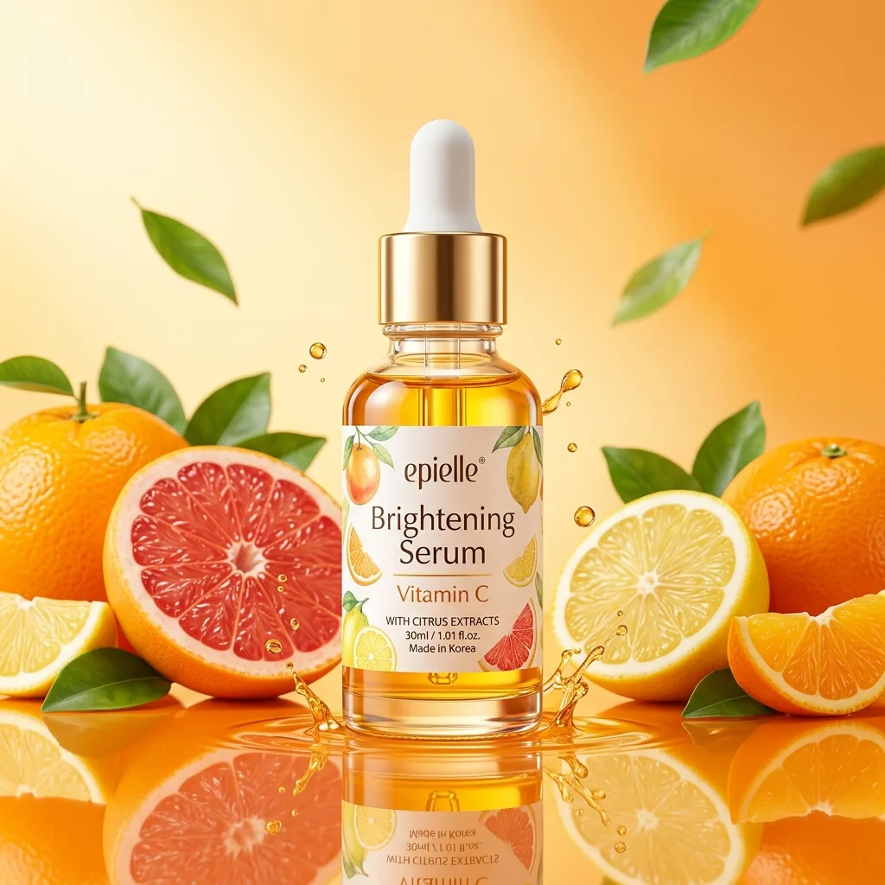

# Ultra-high-end true-to-life photorealistic skincare product photography featuring a clear

[← Back to the collection](../../README.md) · Category: [Product & Brand](../../gallery/product-brand.md) · Model: `Vinano Image Pro` · ID: `vn-00464`

<a href="https://vinano.ai?utm_source=github&utm_medium=readme&utm_campaign=awesome-image-video-prompts-updating&utm_content=prompt-page-image"></a>

<sub>Preview generated with <a href="https://vinano.ai?utm_source=github&utm_medium=readme&utm_campaign=awesome-image-video-prompts-updating&utm_content=prompt-page-caption">vinano.ai</a></sub>

## Prompt

```text
Ultra-high-end true-to-life photorealistic skincare product photography featuring a clear cylindrical glass dropper bottle filled translucent golden serum, centered and slightly tilted backward, a matte white rubber dropper and metallic gold collar, the front label clearly reading “epielle Brightening Serum Vitamin C” citrus illustrations, placed on a glossy reflective orange liquid surface creating a sharp mirror reflection beneath the bottle, surrounded by whole and sliced citrus fruits including bright orange oranges, a halved ruby grapefruit visible pulp, and a sliced yellow lemon positioned symmetrically around the bottle, small golden serum droplets and splashes frozen mid-air around the base, fresh green citrus leaves floating softly in the background, background consisting of a smooth warm gradient transitioning from pale yellow on the left to deep orange on the right, lighting is strong soft studio lighting from upper left creating crisp highlights on glass and liquid, luminous glow through the serum, subtle shadows, and high contrast reflections, color palette dominated by vibrant orange, yellow, gold, and fresh green accents, textures extremely detailed including glossy glass, liquid viscosity, citrus peel pores, juicy pulp, and reflective surface, shallow depth of field razor-sharp focus on the bottle label and fruit in the midground and gentle bokeh in the background, premium commercial cosmetic advertising style, clean modern composition, cinematic realism, ultra-detailed 8K photorealism, studio-grade quality Aim for an editorial, design-driven look with deliberate negative space.
```

## Try it on vinano.ai

1. Copy the prompt above.
2. Open **[vinano.ai](https://vinano.ai?utm_source=github&utm_medium=readme&utm_campaign=awesome-image-video-prompts-updating&utm_content=prompt-page-try)**, paste it into the image generator and pick a model.
3. Swap any placeholders (brand, product, city, person…) for your own details, then generate.

More prompts like this: [Product & Brand gallery](../../gallery/product-brand.md) · [all categories](../../README.md#contents)
