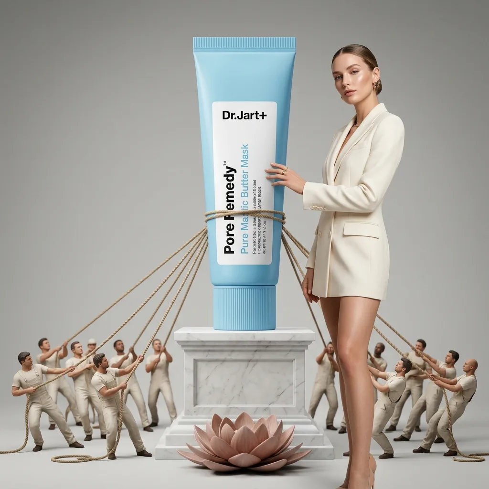

# Surreal, refined minimalist luxury advertising scene in a clean

[← Back to the collection](../../README.md) · Category: [Product & Brand](../../gallery/product-brand.md) · Model: `Vinano Image Pro` · ID: `vn-00468`

<a href="https://vinano.ai?utm_source=github&utm_medium=readme&utm_campaign=awesome-image-video-prompts-updating&utm_content=prompt-page-image"></a>

<sub>Preview generated with <a href="https://vinano.ai?utm_source=github&utm_medium=readme&utm_campaign=awesome-image-video-prompts-updating&utm_content=prompt-page-caption">vinano.ai</a></sub>

## Prompt

```text
A surreal, refined minimalist luxury advertising scene in a clean modern studio a soft neutral gray background, dramatic directional lighting and subtle cinematic shadows. A gigantic oversized tube of Dr.Jart+ Pore Remedy Pure Mastic Butter Mask (light blue tube, white label, bold black “Dr.Jart+” text clearly visible) stands triumphantly on a tall multi-tiered white marble pedestal like a monument. Around the base, 20–30 tiny realistic miniature male workers in matching beige/off-white uniforms and overalls are pulling thick ropes tied around the massive tube, straining intense effort, dynamic poses, muscles tense, tugging mostly forward.

Place a tall elegant Western woman in her late 20s in the foreground, positioned much closer to the camera for a stronger ad focus. She stands slightly in front of the pedestal, waist-up to mid-thigh framing, creating a premium beauty campaign feel. She has glowing fair skin, sharp cheekbones, soft natural makeup luminous skin finish, slick low bun hairstyle, and a confident high-fashion gaze directed toward the camera. She wears a structured ivory tailored blazer dress minimal gold accessories and nude heels. One hand lightly touches the giant tube while her body subtly angles toward it, creating a powerful hero-product connection.

At the foot of the pedestal lies a large open lotus flower sculpture in soft pinkish-brown tones. High-end commercial skincare photography, hyper-realistic 3D render, ultra-sharp 8K details, cinematic composition, shallow depth of field slightly blurring the miniature workers while keeping the woman and product crisp and dominant, luxury beauty campaign aesthetic, epic scale contrast, clean elegant studio environment, shot by Veo.

Maintain consistent colour harmony and crisp focus across the whole frame.
```

## Try it on vinano.ai

1. Copy the prompt above.
2. Open **[vinano.ai](https://vinano.ai?utm_source=github&utm_medium=readme&utm_campaign=awesome-image-video-prompts-updating&utm_content=prompt-page-try)**, paste it into the image generator and pick a model.
3. Swap any placeholders (brand, product, city, person…) for your own details, then generate.

More prompts like this: [Product & Brand gallery](../../gallery/product-brand.md) · [all categories](../../README.md#contents)
