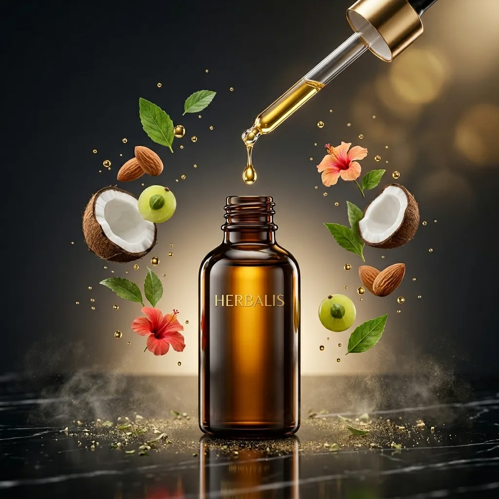

# Luxurious branded herbal hair oil

[← Back to the collection](../../README.md) · Category: [Product & Brand](../../gallery/product-brand.md) · Model: `Vinano Image Pro` · ID: `vn-00488`

<a href="https://vinano.ai?utm_source=github&utm_medium=readme&utm_campaign=awesome-image-video-prompts-updating&utm_content=prompt-page-image"></a>

<sub>Preview generated with <a href="https://vinano.ai?utm_source=github&utm_medium=readme&utm_campaign=awesome-image-video-prompts-updating&utm_content=prompt-page-caption">vinano.ai</a></sub>

## Prompt

```text
{
 "master_prompt": {
 "scene_type": "ultra-premium cinematic luxury hair oil product photography",

 "product": {
 "type": "luxurious branded herbal hair oil",
 "container": "premium dark amber glass bottle elegant gold dropper cap",
 "label": "minimal luxury branding embossed gold typography",
 "oil_texture": "rich golden oil crystal clarity and glossy viscosity",
 "ingredients_visual": ["fresh coconut halves",
 "amla berries",
 "almonds",
 "hibiscus flowers",
 "green herbal leaves"]
 },

 "composition": {
 "action": "golden hair oil droplets pouring elegantly from a glass dropper captured mid-air",
 "surrounding_elements": ["floating herbal ingredients suspended in motion",
 "tiny golden oil droplets sparkling in light",
 "soft mist of botanical particles",
 "subtle golden dust accents for premium feel"],
 "placement": "hero bottle centered on polished black marble surface luxury reflections"
 },

 "lighting": {
 "style": "luxury cosmetic studio lighting",
 "effects": ["soft rim lighting outlining the bottle silhouette",
 "warm backlight illuminating the golden oil inside the bottle",
 "gentle top light highlighting the glass dropper and oil droplets",
 "subtle side lighting enhancing glass reflections"]
 },

 "color_palette": {
 "background": "deep charcoal fading into warm golden bokeh",
 "accents": "rich amber gold, botanical green, glossy black reflections, subtle champagne highlights"
 },

 "technical_specs": {
 "camera": "macro lens slight low angle for premium dominance",
 "shutter": "ultra-fast freeze motion capturing oil droplets",
 "depth_of_field": "shallow focus on bottle and dropper cinematic background blur",
 "quality": "8K resolution, ultra-true-to-life photorealistic cosmetic product detailing"
 }
 }
}

Aim for an editorial, design-driven look with deliberate negative space.
```

## Try it on vinano.ai

1. Copy the prompt above.
2. Open **[vinano.ai](https://vinano.ai?utm_source=github&utm_medium=readme&utm_campaign=awesome-image-video-prompts-updating&utm_content=prompt-page-try)**, paste it into the image generator and pick a model.
3. Swap any placeholders (brand, product, city, person…) for your own details, then generate.

More prompts like this: [Product & Brand gallery](../../gallery/product-brand.md) · [all categories](../../README.md#contents)
