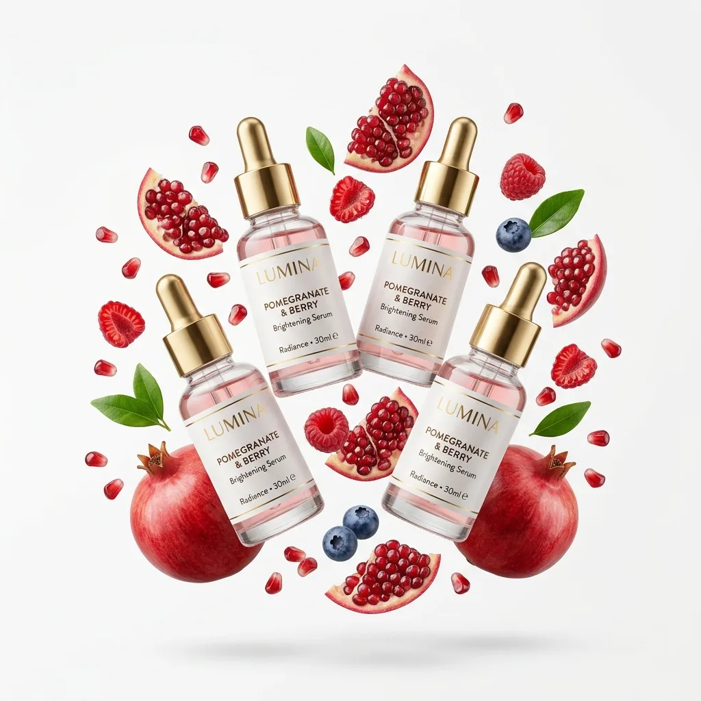

# Product , 3–4 identical units of the product floating

[← Back to the collection](../../README.md) · Category: [Product & Brand](../../gallery/product-brand.md) · Model: `Vinano Image Pro` · ID: `vn-00490`

<a href="https://vinano.ai?utm_source=github&utm_medium=readme&utm_campaign=awesome-image-video-prompts-updating&utm_content=prompt-page-image"></a>

<sub>Preview generated with <a href="https://vinano.ai?utm_source=github&utm_medium=readme&utm_campaign=awesome-image-video-prompts-updating&utm_content=prompt-page-caption">vinano.ai</a></sub>

## Prompt

```text
[product], 3–4 identical units of the product floating in mid-air, surrounded by fresh [fruit/vegetable] and sliced pieces that the product is made from, ingredients suspended around the product, dynamic balanced composition, ultra-clean pure white background, no gradients, no color cast, soft studio lighting, realistic soft shadows beneath floating objects, glossy packaging reflections, juicy ingredient textures, premium skincare editorial style, hyper-realistic product photography, macro detail, sharp focus, commercial advertising quality, minimal composition, 8k, 1:1 Aim for an editorial, design-driven look with deliberate negative space.
```

## Try it on vinano.ai

1. Copy the prompt above.
2. Open **[vinano.ai](https://vinano.ai?utm_source=github&utm_medium=readme&utm_campaign=awesome-image-video-prompts-updating&utm_content=prompt-page-try)**, paste it into the image generator and pick a model.
3. Swap any placeholders (brand, product, city, person…) for your own details, then generate.

More prompts like this: [Product & Brand gallery](../../gallery/product-brand.md) · [all categories](../../README.md#contents)
