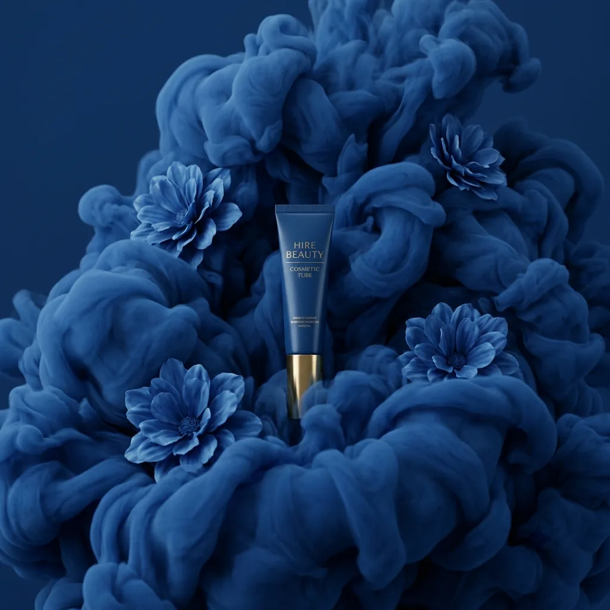

# Use the uploaded image as the exact visual reference

[← Back to the collection](../../README.md) · Category: [Product & Brand](../../gallery/product-brand.md) · Model: `Vinano Image Pro` · ID: `vn-00497`

<a href="https://vinano.ai?utm_source=github&utm_medium=readme&utm_campaign=awesome-image-video-prompts-updating&utm_content=prompt-page-image"></a>

<sub>Preview generated with <a href="https://vinano.ai?utm_source=github&utm_medium=readme&utm_campaign=awesome-image-video-prompts-updating&utm_content=prompt-page-caption">vinano.ai</a></sub>

## Prompt

```text
Use the uploaded image as the exact visual reference.
Keep the product centered.
Do not change the tube position, lighting tone, flower placement, or color palette.
Maintain the deep blue monochromatic aesthetic.
No additional lights.
No color grading changes.
Camera:
Locked camera.
No zoom.
No rotation.
No angle change.
Static premium composition.
Action:
Animate the surrounding voluminous blue swirling clouds in ultra slow motion.
The cloud-like forms (soft fabric/ink-style swirls) gently move and curl around the product.
Movement should feel fluid, heavy, and luxurious.
Soft rolling motion from bottom to top.
Subtle inward spiral motion around the tube.
No aggressive motion.
No fast movement.
No deformation of the product.
Flowers:
Remain mostly stable.
Very subtle natural micro movement as if lightly affected by airflow.
Petals should not detach.
No new petals added.
Physics:
Smooth, dense, smoke-like simulation.
Velvety texture.
Soft shadow transitions within the folds.
Natural depth and layering.

Mood:
Elegant.
Premium.
Artistic beauty campaign.
High-end cosmetic advertisement.

Sound (optional if supported):
Soft ambient atmospheric tone.
Very subtle airy texture.
No voiceover.
End Frame:
Clouds continue slowly flowing around the product.
Product remains sharp and perfectly centered.
Ultra realistic.
Luxury slow-motion finish.

Maintain consistent colour harmony and crisp focus across the whole frame.
```

## Try it on vinano.ai

1. Copy the prompt above.
2. Open **[vinano.ai](https://vinano.ai?utm_source=github&utm_medium=readme&utm_campaign=awesome-image-video-prompts-updating&utm_content=prompt-page-try)**, paste it into the image generator and pick a model.
3. Swap any placeholders (brand, product, city, person…) for your own details, then generate.

More prompts like this: [Product & Brand gallery](../../gallery/product-brand.md) · [all categories](../../README.md#contents)
