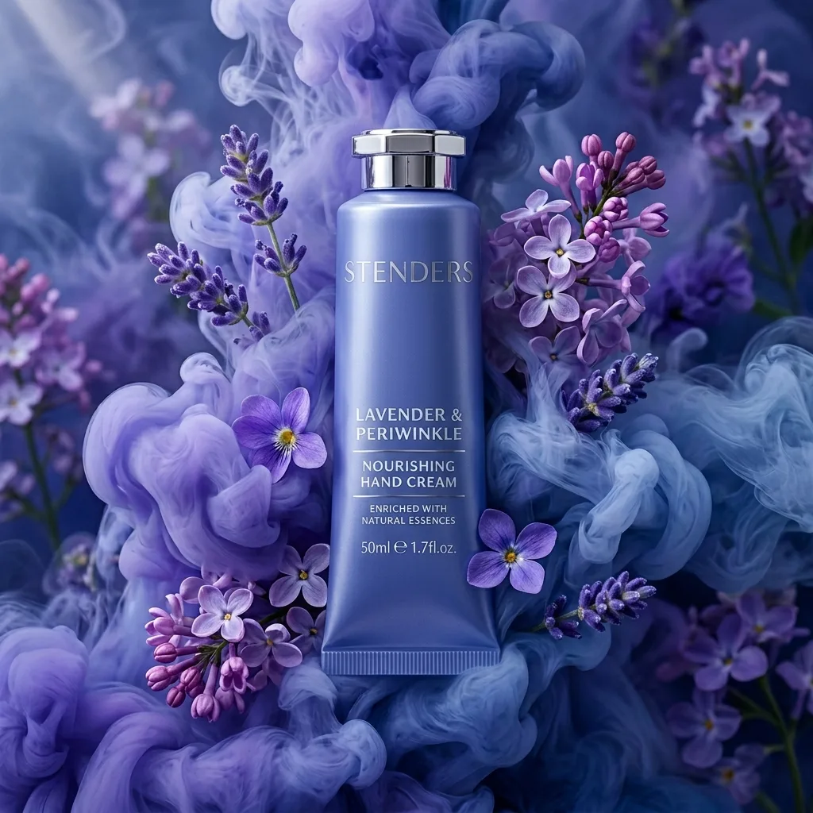

# Luxury cosmetic product photography in a dramatic monochromatic blue-violet

[← Back to the collection](../../README.md) · Category: [Product & Brand](../../gallery/product-brand.md) · Model: `Vinano Image Pro` · ID: `vn-00514`

<a href="https://vinano.ai?utm_source=github&utm_medium=readme&utm_campaign=awesome-image-video-prompts-updating&utm_content=prompt-page-image"></a>

<sub>Preview generated with <a href="https://vinano.ai?utm_source=github&utm_medium=readme&utm_campaign=awesome-image-video-prompts-updating&utm_content=prompt-page-caption">vinano.ai</a></sub>

## Prompt

```text
Ultra-realistic luxury cosmetic product photography in a dramatic monochromatic blue-violet composition. A sleek satin-finish periwinkle-blue squeeze tube labeled “STENDERS” stands vertically centered in the frame, featuring elegant silver typography and a reflective metallic chrome cap. The tube is surrounded by voluminous swirling clouds of ink-like smoke in layered shades of lavender, indigo, and icy blue, creating a soft, billowing texture that wraps around the product. Interwoven throughout the smoke are fresh purple and lilac flowers intricate petal details and vibrant yellow centers, along delicate sprigs of tiny violet blossoms for added dimension. Soft directional lighting from the upper left highlights the smooth curvature of the tube, adds subtle sheen to the metallic cap, and creates depth within the smoke plumes. The background seamlessly blends cool blue and purple tones, enhancing the ethereal, floral fragrance aesthetic. Hyper-detailed textures of petals and vapor, cinematic depth, high-end perfumed skincare advertising style, 8K

ultra-high resolution

Emphasise material texture and natural light so the final frame feels tactile and premium.
```

## Try it on vinano.ai

1. Copy the prompt above.
2. Open **[vinano.ai](https://vinano.ai?utm_source=github&utm_medium=readme&utm_campaign=awesome-image-video-prompts-updating&utm_content=prompt-page-try)**, paste it into the image generator and pick a model.
3. Swap any placeholders (brand, product, city, person…) for your own details, then generate.

More prompts like this: [Product & Brand gallery](../../gallery/product-brand.md) · [all categories](../../README.md#contents)
