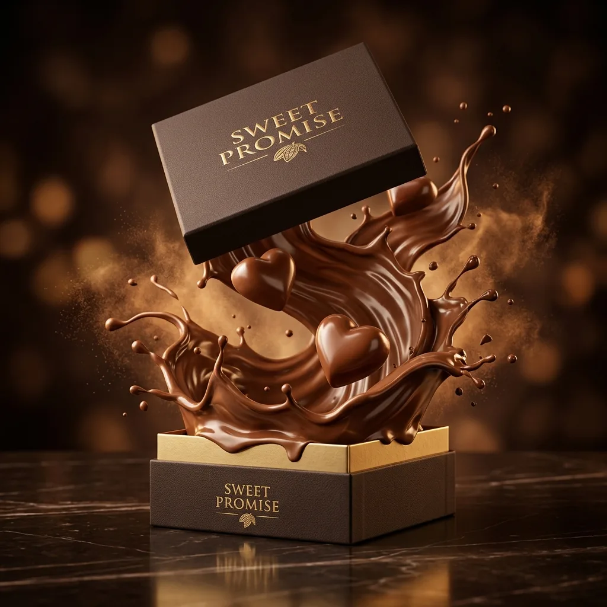

# Slow, sensual luxury chocolate commercial shot in ultra-high definition

[← Back to the collection](../../README.md) · Category: [Product & Brand](../../gallery/product-brand.md) · Model: `Vinano Image Pro` · ID: `vn-00519`

<a href="https://vinano.ai?utm_source=github&utm_medium=readme&utm_campaign=awesome-image-video-prompts-updating&utm_content=prompt-page-image"></a>

<sub>Preview generated with <a href="https://vinano.ai?utm_source=github&utm_medium=readme&utm_campaign=awesome-image-video-prompts-updating&utm_content=prompt-page-caption">vinano.ai</a></sub>

## Prompt

```text
A slow, sensual luxury chocolate commercial shot in ultra-high definition. The scene opens in near darkness as a premium espresso-brown gift box soft gold accents slowly rotates on a reflective surface. A warm spotlight reveals the embossed title “SWEET PROMISE” in an elegant serif font, paired a subtle botanical emblem. As the lid gently lifts in slow motion, molten milk chocolate surges upward in a gravity-defying burst, captured at 120fps for dramatic fluid motion. Glossy heart-shaped chocolates rise and orbit the splash, rotating gracefully at different depths, their surfaces catching highlights like polished jewels. Thick chocolate ribbons stretch, drip, and shatter into silky droplets mid-air while cocoa powder blooms softly like a golden mist. Cinematic mocha-and-gold color grading, shallow depth of field, creamy bokeh background, soft rim lighting outlining every chocolate curve. Macro close-ups transition into wide hero shots, emphasizing texture, gloss, and richness. The motion feels slow, seductive, and indulgent—pure luxury confectionery advertising, premium product film, elegant pacing, emotionally rich, visually irresistible. Emphasise material texture and natural light so the final frame feels tactile and premium.
```

## Try it on vinano.ai

1. Copy the prompt above.
2. Open **[vinano.ai](https://vinano.ai?utm_source=github&utm_medium=readme&utm_campaign=awesome-image-video-prompts-updating&utm_content=prompt-page-try)**, paste it into the image generator and pick a model.
3. Swap any placeholders (brand, product, city, person…) for your own details, then generate.

More prompts like this: [Product & Brand gallery](../../gallery/product-brand.md) · [all categories](../../README.md#contents)
