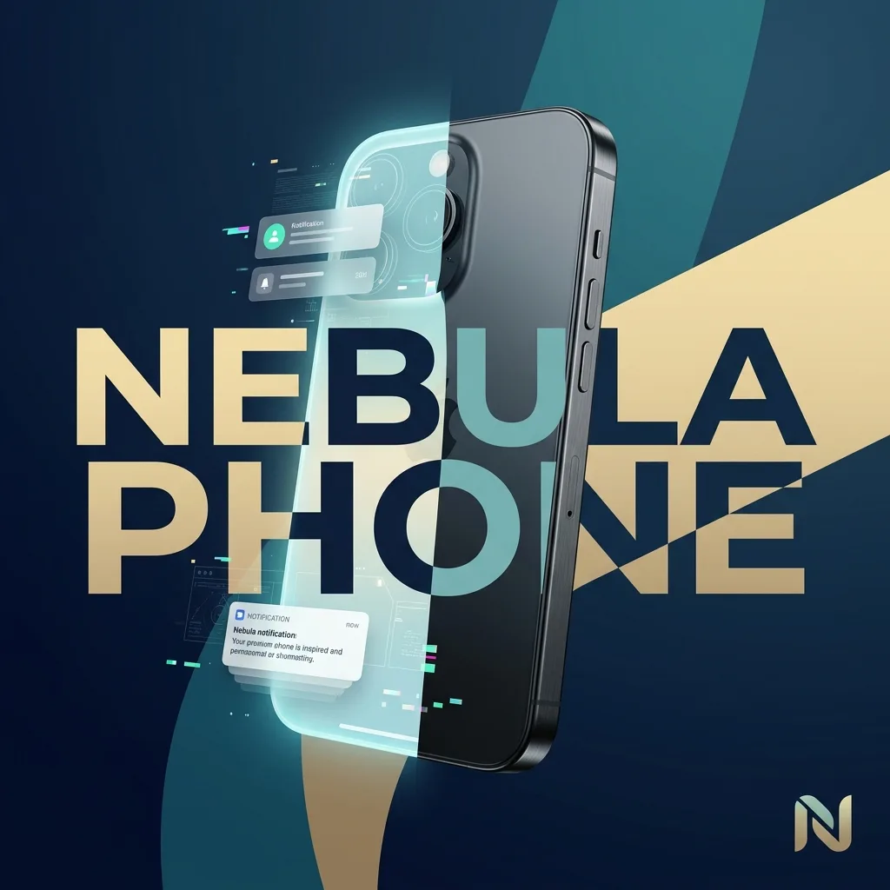

# Product & Brand prompt #547

[← Back to the collection](../../README.md) · Category: [Product & Brand](../../gallery/product-brand.md) · Model: `Vinano Image Pro` · ID: `vn-00547`

<a href="https://vinano.ai?utm_source=github&utm_medium=readme&utm_campaign=awesome-image-video-prompts-updating&utm_content=prompt-page-image"></a>

<sub>Preview generated with <a href="https://vinano.ai?utm_source=github&utm_medium=readme&utm_campaign=awesome-image-video-prompts-updating&utm_content=prompt-page-caption">vinano.ai</a></sub>

## Prompt

```text
Create a 1:1 cinematic product poster (1080×1080) of [BRAND & PRODUCT], centered and fully visible, floating against a clean background inspired by the brand’s core color palette.

The product must remain intact and uncut, but be conceptually split by design:
• One half is true-to-life photorealistic, showcasing accurate materials, textures, reflections, buttons, surfaces, and premium build quality
• The other half transforms seamlessly into flat digital elements that represent the brand’s ecosystem — UI fragments, abstract tech shapes, interface cards, schematic overlays, soft holographic effects, or minimal glitch-style geometry

Lighting:
Cinematic, high-end studio lighting controlled highlights and soft shadows, emphasizing form and depth.

Typography:
Bold double-exposure style text displaying the product or brand name, integrated cleanly into the composition.
Official logo placed subtly and professionally in one corner.

Preserve realistic proportions and depth for a confident, professional finish.
```

## Try it on vinano.ai

1. Copy the prompt above.
2. Open **[vinano.ai](https://vinano.ai?utm_source=github&utm_medium=readme&utm_campaign=awesome-image-video-prompts-updating&utm_content=prompt-page-try)**, paste it into the image generator and pick a model.
3. Swap any placeholders (brand, product, city, person…) for your own details, then generate.

More prompts like this: [Product & Brand gallery](../../gallery/product-brand.md) · [all categories](../../README.md#contents)
