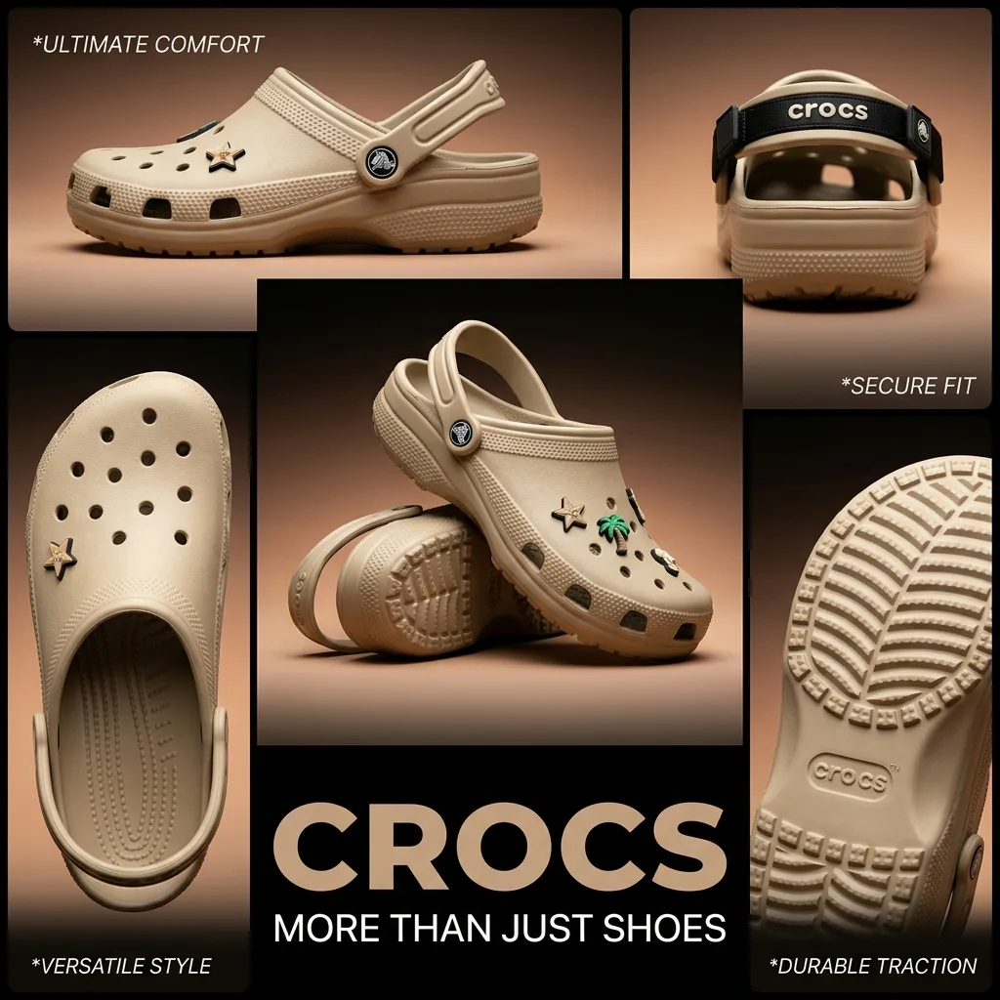

# Multi-image product collage poster featuring beige/tan Crocs clog shoes

[← Back to the collection](../../README.md) · Category: [Product & Brand](../../gallery/product-brand.md) · Model: `Vinano Image Pro` · ID: `vn-00576`

<a href="https://vinano.ai?utm_source=github&utm_medium=readme&utm_campaign=awesome-image-video-prompts-updating&utm_content=prompt-page-image"></a>

<sub>Preview generated with <a href="https://vinano.ai?utm_source=github&utm_medium=readme&utm_campaign=awesome-image-video-prompts-updating&utm_content=prompt-page-caption">vinano.ai</a></sub>

## Prompt

```text
Multi-image product collage poster featuring beige/tan Crocs clog shoes, designed as a modern footwear advertisement.

The layout combines multiple product angles arranged in a structured grid:

Side profile view showing the clog silhouette and ventilation holes

Rear view highlighting the heel strap and branding

Top-down view showing the cushioned footbed texture

Close-up detail of the sole tread and side logo

A hero product image in the foreground one shoe stacked against another, creating depth

Clean studio background a warm brown-to-black gradient, giving a cozy, lifestyle-oriented tone.
The Crocs appear matte, lightweight, and comfortable, realistic foam texture and soft shadows.

Large bold headline typography at the bottom reads:
“CROCS”
Subheading: “MORE THAN JUST SHOES”

Small blocks of descriptive lifestyle copy appear subtly in the background, reinforcing comfort, durability, and versatility. Overall composition feels like a social media brand post or poster ad.

Visual Style

Modern product advertising
Lifestyle + catalog hybrid
Warm earthy color palette
Soft studio lighting
true-to-life photorealistic textures
crisp composition
Professional footwear photography

Camera & Composition

Multiple angles combined into one layout
85mm–100mm product photography look
Sharp focus on shoes
Soft shadows beneath products
Balanced exposure
No distortion

Mood & Branding

Comfort
Everyday lifestyle
Durable
Casual confidence
Practical yet stylish
Approachable brand feel

Negative Prompt

Low resolution, incorrect shoe shape, warped branding, misspelled logo, glossy plastic look, harsh reflections, cluttered layout, inconsistent lighting, cartoon style, CGI look, watermark, text artifacts

Keep edges clean and the overall composition balanced for a polished, gallery-ready result.
```

## Try it on vinano.ai

1. Copy the prompt above.
2. Open **[vinano.ai](https://vinano.ai?utm_source=github&utm_medium=readme&utm_campaign=awesome-image-video-prompts-updating&utm_content=prompt-page-try)**, paste it into the image generator and pick a model.
3. Swap any placeholders (brand, product, city, person…) for your own details, then generate.

More prompts like this: [Product & Brand gallery](../../gallery/product-brand.md) · [all categories](../../README.md#contents)
