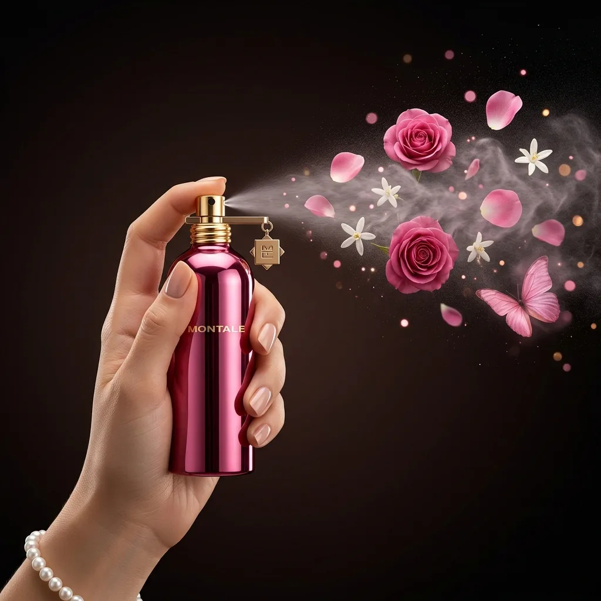

# Human hand holding a metallic pink perfume bottle

[← Back to the collection](../../README.md) · Category: [Product & Brand](../../gallery/product-brand.md) · Model: `Vinano Image Pro` · ID: `vn-00596`

<a href="https://vinano.ai?utm_source=github&utm_medium=readme&utm_campaign=awesome-image-video-prompts-updating&utm_content=prompt-page-image"></a>

<sub>Preview generated with <a href="https://vinano.ai?utm_source=github&utm_medium=readme&utm_campaign=awesome-image-video-prompts-updating&utm_content=prompt-page-caption">vinano.ai</a></sub>

## Prompt

```text
{
 "resolution": "8K",
 "aspect_ratio": "3:4",
 "style": "high-end AI-edited studio photography",
 "subject": {
 "primary": "human hand holding a metallic pink perfume bottle",
 "hand_details": {
 "skin": "smooth, well-groomed",
 "nails": "short to medium length, natural nude tone",
 "accessory": "white pearl bracelet on wrist"
 },
 "bottle": {
 "material": "metallic reflective",
 "color": "deep metallic pink",
 "shape": "cylindrical rounded shoulders",
 "nozzle": "gold spray nozzle, cap removed",
 "charm": {
 "material": "gold",
 "shape": "small geometric star-like tag",
 "attachment": "hanging from bottle neck thin metal loop"
 },
 "visible_text": "MONTALE"
 }
 },
 "action": {
 "spray": {
 "type": "fine atomized mist",
 "direction": "left to right",
 "texture": "soft, smoke-like, semi-transparent"
 }
 },
 "elements_emerging_from_mist": {
 "flowers": {
 "pink_roses": "fully bloomed roses floating in air",
 "rose_petals": "individual pink petals suspended mid-air",
 "white_flowers": "small star-shaped white blossoms thin petals"
 },
 "butterfly": {
 "color": "pink",
 "wings": "semi-translucent visible veins",
 "position": "right side of frame"
 },
 "particles": {
 "type": "small glowing bokeh-like specks",
 "colors": ["soft pink", "warm gold"]
 }
 },
 "background": {
 "color": "dark black to deep brown gradient",
 "environment": "studio, no visible location"
 },
 "lighting": {
 "type": "soft cinematic studio lighting",
 "highlights": ["bottle curves", "gold nozzle", "mist", "flowers"],
 "contrast": "high subject-to-background contrast"
 },
 "composition": {
 "orientation": "vertical",
 "subject_position": "slightly left of center",
 "depth": "foreground hand, mid-air mist and flowers, dark background"
 },
 "quality": {
 "sharpness": "ultra-sharp",
 "detail_level": "extreme micro-detail",
 "finish": "luxury advertising grade"
 }
}

Keep edges clean and the overall composition balanced for a polished, gallery-ready result.
```

## Try it on vinano.ai

1. Copy the prompt above.
2. Open **[vinano.ai](https://vinano.ai?utm_source=github&utm_medium=readme&utm_campaign=awesome-image-video-prompts-updating&utm_content=prompt-page-try)**, paste it into the image generator and pick a model.
3. Swap any placeholders (brand, product, city, person…) for your own details, then generate.

More prompts like this: [Product & Brand gallery](../../gallery/product-brand.md) · [all categories](../../README.md#contents)
