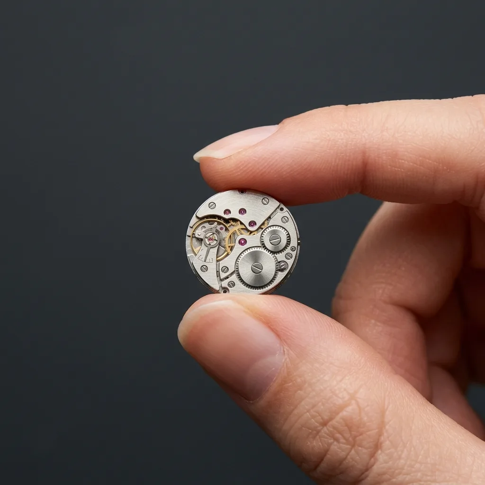

# Macro photograph, refined minimalist advertising style, a hyper-realistic miniature

[← Back to the collection](../../README.md) · Category: [Product & Brand](../../gallery/product-brand.md) · Model: `Vinano Image Pro` · ID: `vn-00607`

<a href="https://vinano.ai?utm_source=github&utm_medium=readme&utm_campaign=awesome-image-video-prompts-updating&utm_content=prompt-page-image"></a>

<sub>Preview generated with <a href="https://vinano.ai?utm_source=github&utm_medium=readme&utm_campaign=awesome-image-video-prompts-updating&utm_content=prompt-page-caption">vinano.ai</a></sub>

## Prompt

```text
macro photograph, refined minimalist advertising style, a hyper-realistic miniature [PRODUCT] crafted from [MATERIAL], delicately poised between a person's thumb and forefinger against a seamless, matte [BG_COLOR] cyclorama under professional Top-Down_Spotlight that casts subtle, soft shadows, the impeccably groomed hand accentuating the object's intricate contours while the composition remains perfectly centered a shallow depth of field to highlight its exquisite craftsmanship Keep edges clean and the overall composition balanced for a polished, gallery-ready result.
```

## Try it on vinano.ai

1. Copy the prompt above.
2. Open **[vinano.ai](https://vinano.ai?utm_source=github&utm_medium=readme&utm_campaign=awesome-image-video-prompts-updating&utm_content=prompt-page-try)**, paste it into the image generator and pick a model.
3. Swap any placeholders (brand, product, city, person…) for your own details, then generate.

More prompts like this: [Product & Brand gallery](../../gallery/product-brand.md) · [all categories](../../README.md#contents)
