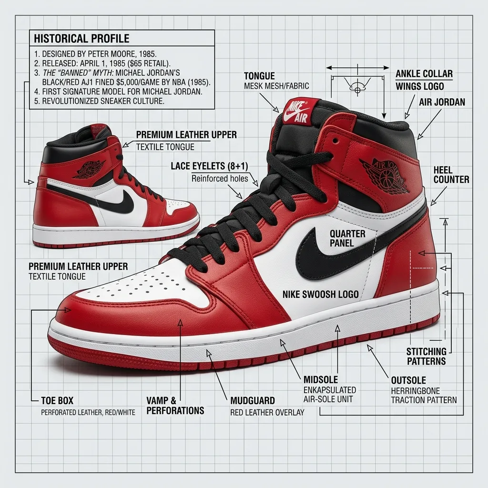

# Infographic image of Nike Air Jordan 1 High OG

[← Back to the collection](../../README.md) · Category: [Product & Brand](../../gallery/product-brand.md) · Model: `Vinano Image Pro` · ID: `vn-00611`

<a href="https://vinano.ai?utm_source=github&utm_medium=readme&utm_campaign=awesome-image-video-prompts-updating&utm_content=prompt-page-image"></a>

<sub>Preview generated with <a href="https://vinano.ai?utm_source=github&utm_medium=readme&utm_campaign=awesome-image-video-prompts-updating&utm_content=prompt-page-caption">vinano.ai</a></sub>

## Prompt

```text
Create an infographic image of Nike Air Jordan 1 High OG sneaker, combining a realistic photograph or photoreal render of the object technical annotation overlays placed directly on top. Use black ink–style line drawings and text (technical pen / engineering diagram aesthetic) for all annotations. Include precise arrows pointing to specific parts, detailed labels naming each component (toe box, swoosh logo, wings logo, collar, tongue, lace holes, midsole, outsole, heel counter, perforations, stitching patterns), materials used (premium leather, rubber outsole, foam cushioning), and historical notes (designed by Peter Moore, 1985, banned by NBA). Show both side profile and slight 3/4 angle. Background should be clean white or very light neutral. Overall style: a hybrid of product photography and vintage technical manual illustration. High resolution, ultra-detailed, 4K quality. Maintain consistent colour harmony and crisp focus across the whole frame.
```

## Try it on vinano.ai

1. Copy the prompt above.
2. Open **[vinano.ai](https://vinano.ai?utm_source=github&utm_medium=readme&utm_campaign=awesome-image-video-prompts-updating&utm_content=prompt-page-try)**, paste it into the image generator and pick a model.
3. Swap any placeholders (brand, product, city, person…) for your own details, then generate.

More prompts like this: [Product & Brand gallery](../../gallery/product-brand.md) · [all categories](../../README.md#contents)
