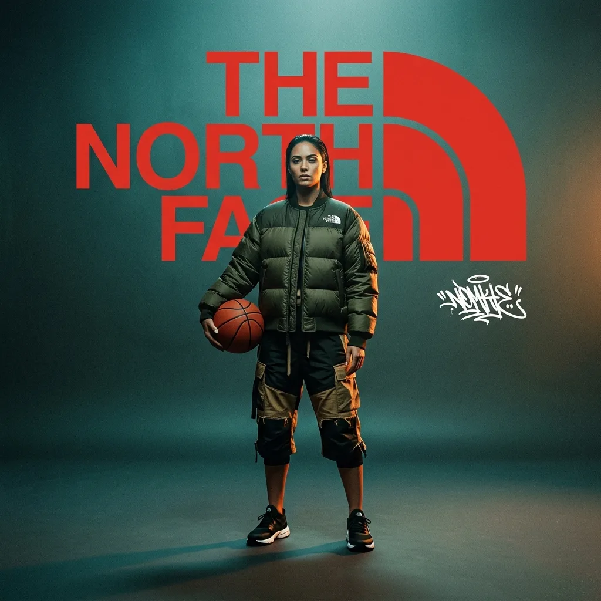

# High-fashion, cinematic brand concept poster for The North Face

[← Back to the collection](../../README.md) · Category: [Product & Brand](../../gallery/product-brand.md) · Model: `Vinano Image Pro` · ID: `vn-00619`

<a href="https://vinano.ai?utm_source=github&utm_medium=readme&utm_campaign=awesome-image-video-prompts-updating&utm_content=prompt-page-image"></a>

<sub>Preview generated with <a href="https://vinano.ai?utm_source=github&utm_medium=readme&utm_campaign=awesome-image-video-prompts-updating&utm_content=prompt-page-caption">vinano.ai</a></sub>

## Prompt

```text
A high-fashion, cinematic brand concept poster for "The North Face." The scene features a woman in the uploaded image, standing in a stylized studio. They are dressed in edgy, oversized urban streetwear: a dark olive-green quilted puffer bomber jacket, layered black and tan distressed techwear shorts below knees, and black sneakers white soles. The person holds a classic orange basketball at their hip. In the background, a massive, bold red "THE NORTH FACE" logo and its iconic half-dome symbol are stacked and centered, dominating the upper half of the frame. To the right of the subject, there's a small white stylized graffiti-style signature. The lighting is moody and dramatic, featuring a teal-tinted atmosphere a warm rim light hitting the subject’s right side. The floor is a dark, smooth studio surface a soft shadow cast forward. The overall aesthetic is gritty, futuristic, and high-contrast, a heavy film grain texture. Render with rich micro-detail while keeping the layout uncluttered and intentional.
```

## Try it on vinano.ai

1. Copy the prompt above.
2. Open **[vinano.ai](https://vinano.ai?utm_source=github&utm_medium=readme&utm_campaign=awesome-image-video-prompts-updating&utm_content=prompt-page-try)**, paste it into the image generator and pick a model.
3. Swap any placeholders (brand, product, city, person…) for your own details, then generate.

More prompts like this: [Product & Brand gallery](../../gallery/product-brand.md) · [all categories](../../README.md#contents)
