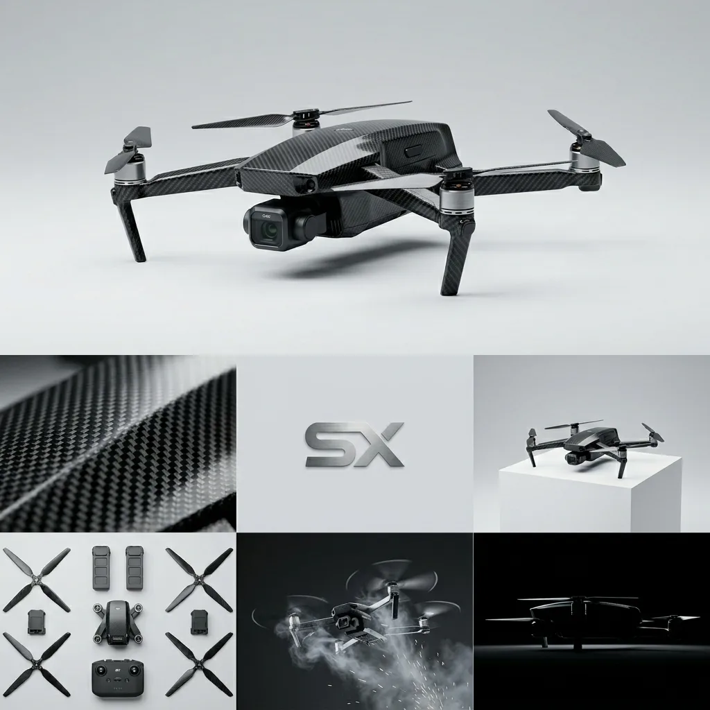

# 8k studio editorial based on ATTACHED INPUT IMAGE

[← Back to the collection](../../README.md) · Category: [Product & Brand](../../gallery/product-brand.md) · Model: `Vinano Image Pro` · ID: `vn-00649`

<a href="https://vinano.ai?utm_source=github&utm_medium=readme&utm_campaign=awesome-image-video-prompts-updating&utm_content=prompt-page-image"></a>

<sub>Preview generated with <a href="https://vinano.ai?utm_source=github&utm_medium=readme&utm_campaign=awesome-image-video-prompts-updating&utm_content=prompt-page-caption">vinano.ai</a></sub>

## Prompt

```text
CORE OBJECTIVE: Create a professional 8k studio editorial based on [ATTACHED_INPUT_IMAGE]. Analyze subject geometry, material, and branding to maintain logic across 7 seamless panels.

STEP 1: DYNAMIC ANALYSIS
Identify: Subject, logo (or name), and material.

Material Logic: Tech (sharp rim lights), Glass (refraction/caustics), Organic (soft light), Fashion (matte/satin sheen).

COMPOSITION & STRUCTURE
Single seamless image. Top: 1 Hero Panel. Bottom: 2x3 Grid (6 panels). Total 7 views. No text or borders (except Frame 2).

PANEL SPECIFICATIONS
MAIN HERO: Centered master portrait on infinite-curve background. Lighting highlights primary material.

F1 (Macro): Extreme close-up on material "DNA" (microscopic grain, textures, or circuitry).

F2 (Logo): 3D premium brand emblem centered on a refined minimalist studio backdrop.

F3 (Scale): Subject in size-appropriate context (gallery for large, pedestal for small).

F4 (Rhythm): High-angle "knolling" or grid repetition of components.

F5 (Motion): Weightless action-still environmental cues (vapor, sparks, or splashes).

F6 (Form): High-contrast rim-lit profile focusing purely on the iconic silhouette.

VISUAL ENFORCEMENT
Style: Ultra-high-end Studio Editorial.

Consistency: 100% identical color and design details across all views.

Technical: 8k, ray-traced reflections, professional grading, global illumination.

Aim for an editorial, design-driven look with deliberate negative space.
```

## Try it on vinano.ai

1. Copy the prompt above.
2. Open **[vinano.ai](https://vinano.ai?utm_source=github&utm_medium=readme&utm_campaign=awesome-image-video-prompts-updating&utm_content=prompt-page-try)**, paste it into the image generator and pick a model.
3. Swap any placeholders (brand, product, city, person…) for your own details, then generate.

More prompts like this: [Product & Brand gallery](../../gallery/product-brand.md) · [all categories](../../README.md#contents)
