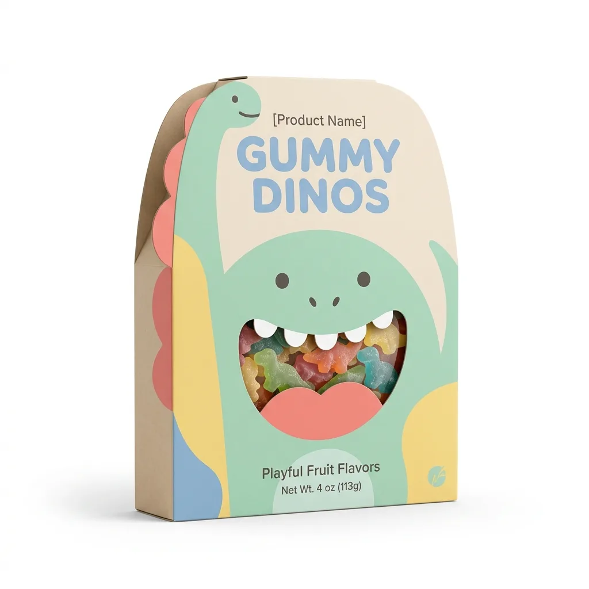

# Playful designer packaging for product name , creative box

[← Back to the collection](../../README.md) · Category: [Product & Brand](../../gallery/product-brand.md) · Model: `Vinano Image Pro` · ID: `vn-00650`

<a href="https://vinano.ai?utm_source=github&utm_medium=readme&utm_campaign=awesome-image-video-prompts-updating&utm_content=prompt-page-image"></a>

<sub>Preview generated with <a href="https://vinano.ai?utm_source=github&utm_medium=readme&utm_campaign=awesome-image-video-prompts-updating&utm_content=prompt-page-caption">vinano.ai</a></sub>

## Prompt

```text
Playful designer packaging for [product name], creative box shaped like the product, integrated cartoon face on the front panel, oversized die-cut window revealing the real contents as part of the character’s expression, smooth matte cardboard material, bold flat graphic design, modern refined minimalist branding, limited pastel color palette, rounded friendly shapes, clean typography, high-end 3D packaging mockup render, soft studio lighting, pure white background, subtle realistic contact shadow beneath, ultra-detailed, retail-ready presentation, 1:1 aspect ratio. Preserve realistic proportions and depth for a confident, professional finish.
```

## Try it on vinano.ai

1. Copy the prompt above.
2. Open **[vinano.ai](https://vinano.ai?utm_source=github&utm_medium=readme&utm_campaign=awesome-image-video-prompts-updating&utm_content=prompt-page-try)**, paste it into the image generator and pick a model.
3. Swap any placeholders (brand, product, city, person…) for your own details, then generate.

More prompts like this: [Product & Brand gallery](../../gallery/product-brand.md) · [all categories](../../README.md#contents)
