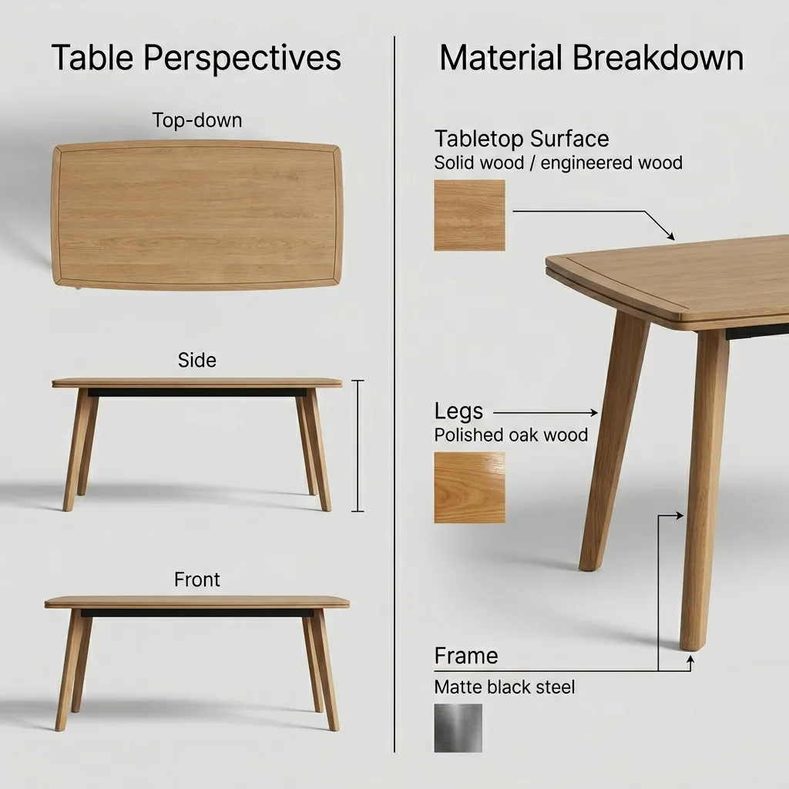

# Product showcase image of a table design multiple perspectives

[← Back to the collection](../../README.md) · Category: [Product & Brand](../../gallery/product-brand.md) · Model: `Vinano Image Pro` · ID: `vn-00657`

<a href="https://vinano.ai?utm_source=github&utm_medium=readme&utm_campaign=awesome-image-video-prompts-updating&utm_content=prompt-page-image"></a>

<sub>Preview generated with <a href="https://vinano.ai?utm_source=github&utm_medium=readme&utm_campaign=awesome-image-video-prompts-updating&utm_content=prompt-page-caption">vinano.ai</a></sub>

## Prompt

```text
{
 "objective": "Create a detailed product showcase image of a table design multiple perspectives and material information",
 "image_specifications": {
 "style": "Realistic 3D render or premium-quality product illustration",
 "layout": "Split view",
 "aspect_ratio": "3:2 or 4:3",
 "background": "Neutral (light gray or white) to enhance clarity and contrast"
 },
 "left_side": {
 "section_title": "Table Perspectives",
 "views": [{
 "view": "Top-down",
 "description": "Display the full table from above, showing tabletop shape, surface texture, and edge details"
 },
 {
 "view": "Side view",
 "description": "Profile of the table to show leg design, table height, and tabletop thickness"
 },
 {
 "view": "Front view",
 "description": "Straight-on view to show width, symmetry, and leg alignment"
 }],
 "visual_style": "Consistent lighting and shadows for realism, subtle shadows to define form"
 },
 "right_side": {
 "section_title": "Material Breakdown",
 "content": [{
 "material": "Tabletop Surface",
 "material_type": "Solid wood / engineered wood",
 "swatch_image": "Close-up wood texture sample",
 "label_style": "Clean sans-serif text arrows pointing to table sections"
 },
 {
 "material": "Legs",
 "material_type": "Polished oak wood or metal",
 "swatch_image": "Close-up material texture sample",
 "label_style": "Consistent labeling visual connection to perspective images"
 },
 {
 "material": "Frame",
 "material_type": "Matte black steel",
 "swatch_image": "Small metallic texture sample",
 "label_style": "refined minimalist annotations"
 }]
 },
 "visual_elements": {
 "separation": "Vertical dividing line or subtle split background",
 "color_palette": "Natural tones for materials, grayscale for background and lines",
 "typography": "Modern, readable font for labels and section titles"
 },
 "output_format": {
 "type": "Image",
 "high_resolution": true,
 "use_case": ["Product sheet", "Interior design catalog", "Furniture showcase"]
 }
}

Maintain consistent colour harmony and crisp focus across the whole frame.
```

## Try it on vinano.ai

1. Copy the prompt above.
2. Open **[vinano.ai](https://vinano.ai?utm_source=github&utm_medium=readme&utm_campaign=awesome-image-video-prompts-updating&utm_content=prompt-page-try)**, paste it into the image generator and pick a model.
3. Swap any placeholders (brand, product, city, person…) for your own details, then generate.

More prompts like this: [Product & Brand gallery](../../gallery/product-brand.md) · [all categories](../../README.md#contents)
