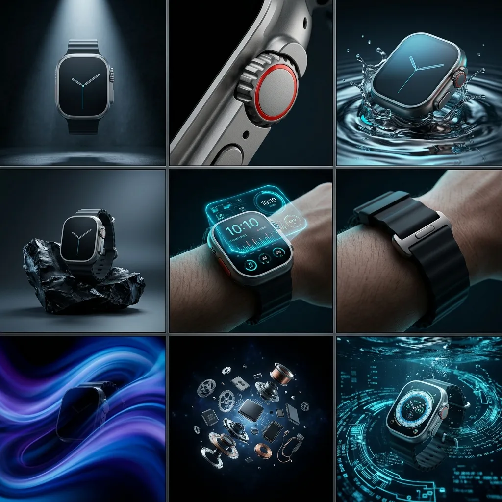

# Titanium Luxury Smartwatch

[← Back to the collection](../../README.md) · Category: [Product & Brand](../../gallery/product-brand.md) · Model: `Vinano Image Pro` · ID: `vn-00663`

<a href="https://vinano.ai?utm_source=github&utm_medium=readme&utm_campaign=awesome-image-video-prompts-updating&utm_content=prompt-page-image"></a>

<sub>Preview generated with <a href="https://vinano.ai?utm_source=github&utm_medium=readme&utm_campaign=awesome-image-video-prompts-updating&utm_content=prompt-page-caption">vinano.ai</a></sub>

## Prompt

```text
{
 "campaign_metadata": {
 "brand_identity": "Quantum Horizon Tech",
 "product_focus": "Titanium Luxury Smartwatch",
 "aspect_ratio": "3:4",
 "aesthetic": "Cyber-Luxury | Technical Minimalism"
 },
 "visual_dna": {
 "materials": ["Brushed Aerospace Titanium", "Sapphire Crystal", "Fluorocarbon Strap"],
 "color_scheme": ["Space Grey", "Electric Cyan", "Matte Black"],
 "lighting": "Top-down Rim Lighting | Neon Accents | Cold Studio Tones"
 },
 "grid_layout_execution": {
 "row_1_precision": {
 "cell_1_1": "Hero: Watch floating vertically, illuminated by a single beam of light.",
 "cell_1_2": "Macro: The digital crown's knurled texture and the red action button detail.",
 "cell_1_3": "Dynamic: Liquid metal ripples splashing against the titanium casing."
 },
 "row_2_lifestyle": {
 "cell_2_1": "Minimal: Watch resting on a raw piece of jagged obsidian rock.",
 "cell_2_2": "Innovation: Holographic UI elements projecting from the watch face into the air.",
 "cell_2_3": "Sensory: Close-up of the strap clicking into the magnetic lug precision."
 },
 "row_3_surreal": {
 "cell_3_1": "Color: A gradient of deep blues and purples light-trail long exposure.",
 "cell_3_2": "Abstraction: Deconstructed internal gears and chips floating like a nebula.",
 "cell_3_3": "Fusion: The watch submerged in a digital 'data' ocean glowing currents."
 }
 }
}

Maintain consistent colour harmony and crisp focus across the whole frame.
```

## Try it on vinano.ai

1. Copy the prompt above.
2. Open **[vinano.ai](https://vinano.ai?utm_source=github&utm_medium=readme&utm_campaign=awesome-image-video-prompts-updating&utm_content=prompt-page-try)**, paste it into the image generator and pick a model.
3. Swap any placeholders (brand, product, city, person…) for your own details, then generate.

More prompts like this: [Product & Brand gallery](../../gallery/product-brand.md) · [all categories](../../README.md#contents)
