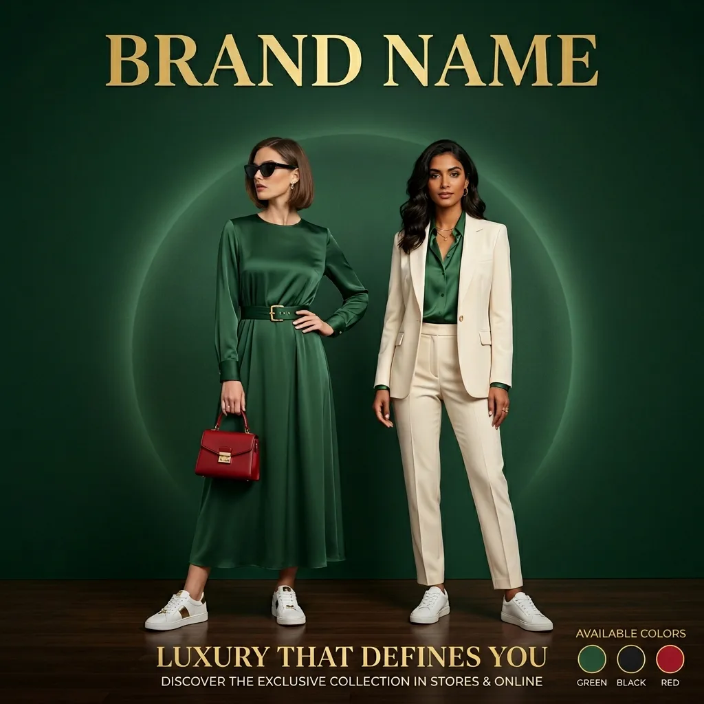

# Luxury fashion advertisement poster, deep green background a soft

[← Back to the collection](../../README.md) · Category: [Product & Brand](../../gallery/product-brand.md) · Model: `Vinano Image Pro` · ID: `vn-00679`

<a href="https://vinano.ai?utm_source=github&utm_medium=readme&utm_campaign=awesome-image-video-prompts-updating&utm_content=prompt-page-image"></a>

<sub>Preview generated with <a href="https://vinano.ai?utm_source=github&utm_medium=readme&utm_campaign=awesome-image-video-prompts-updating&utm_content=prompt-page-caption">vinano.ai</a></sub>

## Prompt

```text
Luxury fashion advertisement poster, deep green background a soft circular gradient behind the model, two stylish female models standing full body. First model wearing a long elegant green dress waist belt, white sneakers, sunglasses, holding a red handbag, confident pose one hand on waist looking sideways. Second female model standing beside her in a different pose, slightly angled stance relaxed arms, wearing a similar elegant fashion outfit matching the luxury theme. Studio lighting, minimal shadows, ultra-crisp composition, premium fashion campaign style.

At the top place large bold luxury serif text “BRAND NAME” (same placement and style as luxury fashion brands).

At the bottom add text:
“LUXURY THAT DEFINES YOU”
Below it smaller text:

Add a small side section titled “AVAILABLE COLORS” three small circular color indicators: Green, Black, Red.

Highly detailed, fashion catalog quality, DSLR photography style, 8k resolution, symmetrical layout, luxury branding aesthetic, professional advertising poster.

Maintain consistent colour harmony and crisp focus across the whole frame.
```

## Try it on vinano.ai

1. Copy the prompt above.
2. Open **[vinano.ai](https://vinano.ai?utm_source=github&utm_medium=readme&utm_campaign=awesome-image-video-prompts-updating&utm_content=prompt-page-try)**, paste it into the image generator and pick a model.
3. Swap any placeholders (brand, product, city, person…) for your own details, then generate.

More prompts like this: [Product & Brand gallery](../../gallery/product-brand.md) · [all categories](../../README.md#contents)
