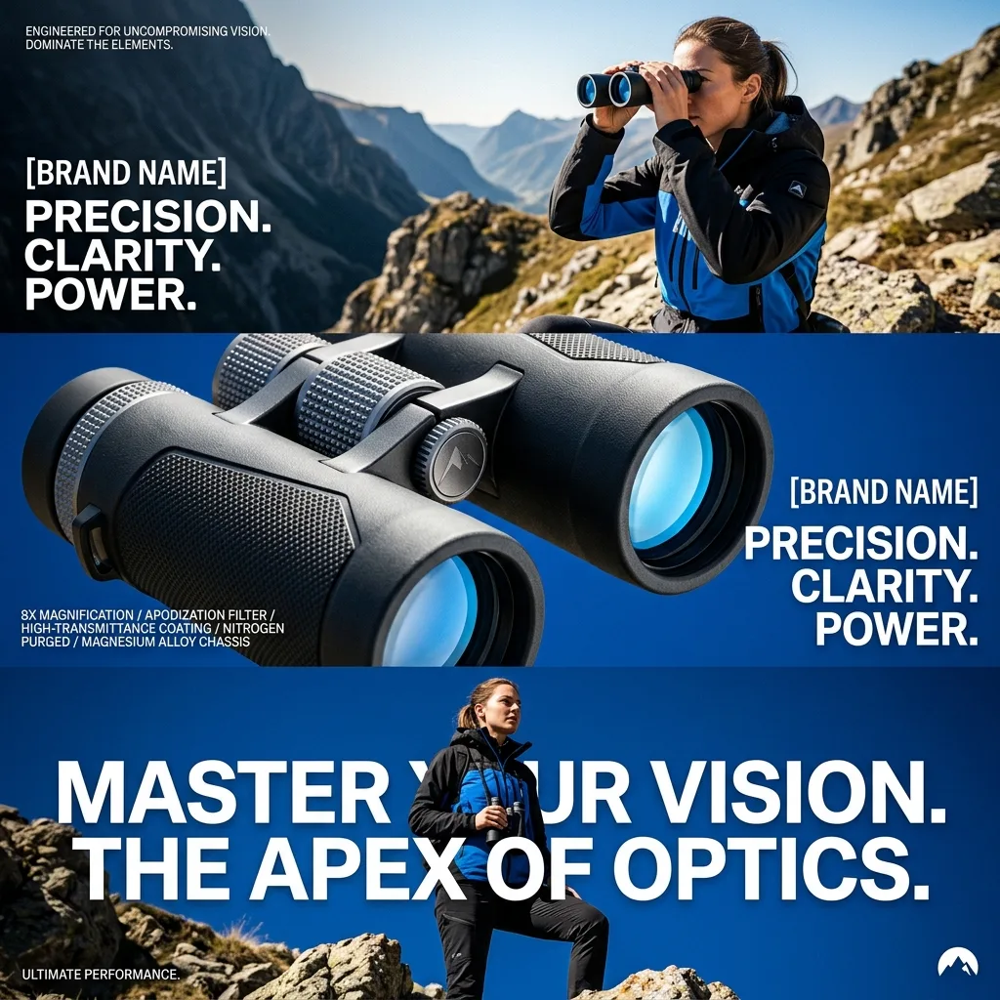

# Product & Brand prompt #696

[← Back to the collection](../../README.md) · Category: [Product & Brand](../../gallery/product-brand.md) · Model: `Vinano Image Pro` · ID: `vn-00696`

<a href="https://vinano.ai?utm_source=github&utm_medium=readme&utm_campaign=awesome-image-video-prompts-updating&utm_content=prompt-page-image"></a>

<sub>Preview generated with <a href="https://vinano.ai?utm_source=github&utm_medium=readme&utm_campaign=awesome-image-video-prompts-updating&utm_content=prompt-page-caption">vinano.ai</a></sub>

## Prompt

```text
[BRAND NAME]. Act as a Senior AI Visual Strategist & Creative Director.
Goal: Analyze the provided [BRAND NAME] and generate a high-end, three-panel vertical manifesto stack. Every element (color, slogan, technical text) must be a logical derivative of the brand's identity.

PHASE 1: AUTONOMOUS BRAND ANALYSIS (INTERNAL SIMULATION)
- Identify the core industry of "[BRAND NAME]".
- Select a high-contrast primary color for the background (e.g., Electric Blue, Racing Red, or Titanium White).
- Generate a powerful 3-word slogan and a 2-line brand philosophy description.
- Generate a block of 5 technical specifications/keywords relevant to the brand's premium products.

PHASE 2: COMPOSITIONAL STRUCTURE (THE VERTICAL STACK)
Layout consists of three wide horizontal panels stacked vertically:
TOP PANEL (Action & Identity): A dynamic wide-angle shot of a professional model the brand's product.
 - Typography (Mid-Left): Place [BRAND NAME] logo and the 3-word slogan in bold white uppercase sans-serif.
 - Micro-Typography (Top-Left corner): Place the 2-line brand philosophy in a tiny, refined minimalist font.
MIDDLE PANEL (The Hero Product & Density): A macro close-up focus on the product's high-fidelity details.
 - Typography (Mid-Right): Place [BRAND NAME] logo and the slogan here to create a diagonal visual flow from the top panel.
 - Technical Density (Bottom-Left corner): Add the 5 technical specifications in sharp, microscopic uppercase font to create a "technical blueprint" aesthetic and fill the negative space.
BOTTOM PANEL (The Power Pose): A low-angle "hero shot" of the model.
 - Mega-Typography: Two massive, high-contrast slogans in white bold sans-serif overlaid across the center of the frame.
 - Corner Accents: A small brand icon in the bottom-right; a secondary micro-text in the bottom-left corner.

PHASE 3: LIGHTING & TEXTURE STANDARDS
- Lighting: Hard, direct "High-Noon" sunlight creating crisp, sharp-edged shadows and brilliant highlights (Chiaroscuro).
- Textures: Extreme fidelity in skin pores, fabric weaves (tech-mesh, leather, carbon fiber), and precision-engineered materials. Zero "AI-plastic" look.

PHASE 4: TECH SPECS
8K Resolution. Render: Octane/Redshift. Global Illumination. Ray Traced reflections. Cinematic photo grain.

Render with rich micro-detail while keeping the layout uncluttered and intentional.
```

## Try it on vinano.ai

1. Copy the prompt above.
2. Open **[vinano.ai](https://vinano.ai?utm_source=github&utm_medium=readme&utm_campaign=awesome-image-video-prompts-updating&utm_content=prompt-page-try)**, paste it into the image generator and pick a model.
3. Swap any placeholders (brand, product, city, person…) for your own details, then generate.

More prompts like this: [Product & Brand gallery](../../gallery/product-brand.md) · [all categories](../../README.md#contents)
