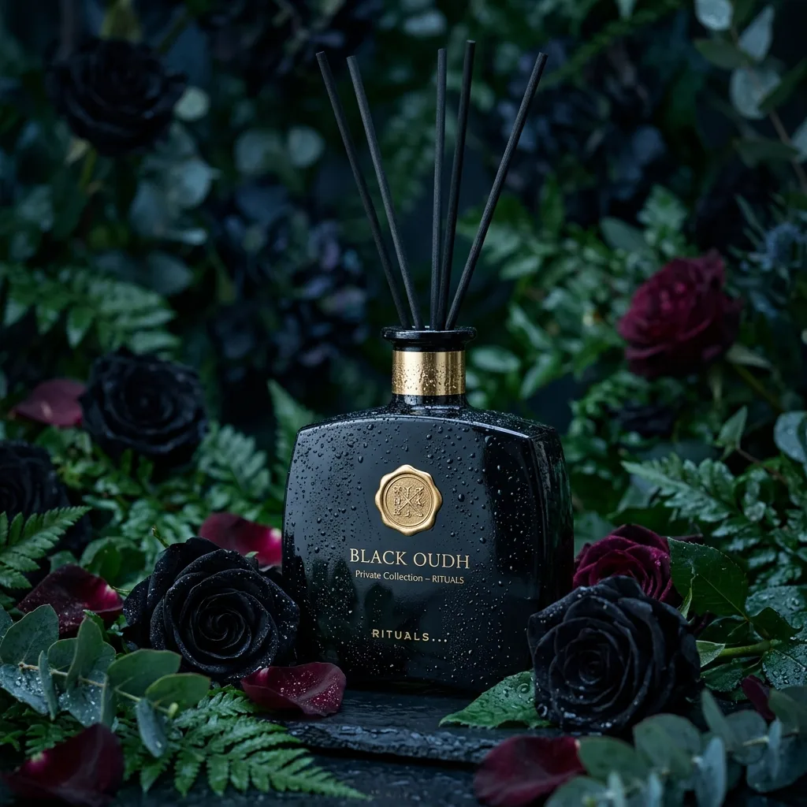

# Luxury product photography of a black glass reed diffuser

[← Back to the collection](../../README.md) · Category: [Product & Brand](../../gallery/product-brand.md) · Model: `Vinano Image Pro` · ID: `vn-00704`

<a href="https://vinano.ai?utm_source=github&utm_medium=readme&utm_campaign=awesome-image-video-prompts-updating&utm_content=prompt-page-image"></a>

<sub>Preview generated with <a href="https://vinano.ai?utm_source=github&utm_medium=readme&utm_campaign=awesome-image-video-prompts-updating&utm_content=prompt-page-caption">vinano.ai</a></sub>

## Prompt

```text
Ultra-realistic luxury product photography of a black glass reed diffuser bottle labeled “BLACK OUDH – Private Collection – RITUALS” in elegant gold serif typography. The bottle has a curved rectangular shape soft edges, a glossy reflective surface, and a gold wax-seal style emblem centered near the top. Thin black diffuser reeds extend upward from the bottle neck.

The bottle is covered in realistic water droplets and condensation, as if freshly misted after rain. It is placed among deep black roses and dark burgundy petals visible water droplets, surrounded by rich green leaves. The scene is moody and dramatic a dark botanical background, softly blurred (shallow depth of field, bokeh effect).

Lighting is cinematic and low-key, soft diffused highlights reflecting off the wet glass surface. Cool-toned lighting (deep greens and midnight blues) enhances the dark, luxurious atmosphere. The gold emblem and lettering subtly catch the light, creating a premium, high-end aesthetic.

Composition: vertical portrait orientation (4:5 ratio), centered product placement, slightly angled bottle resting naturally among roses. Foreground roses partially frame the bottom of the bottle. Background is dark foliage fading into shadow.

Texture emphasis: hyper-detailed water droplets, glossy glass reflections, velvety rose petals, matte black reeds.

Style: high-end commercial fragrance advertising, macro lens, 85mm, f/2.0, shallow depth of field, true-to-life photorealistic, 8K resolution, sharp focus on bottle, dramatic contrast, rich blacks, luxury perfume campaign aesthetic.

Preserve realistic proportions and depth for a confident, professional finish.
```

## Try it on vinano.ai

1. Copy the prompt above.
2. Open **[vinano.ai](https://vinano.ai?utm_source=github&utm_medium=readme&utm_campaign=awesome-image-video-prompts-updating&utm_content=prompt-page-try)**, paste it into the image generator and pick a model.
3. Swap any placeholders (brand, product, city, person…) for your own details, then generate.

More prompts like this: [Product & Brand gallery](../../gallery/product-brand.md) · [all categories](../../README.md#contents)
