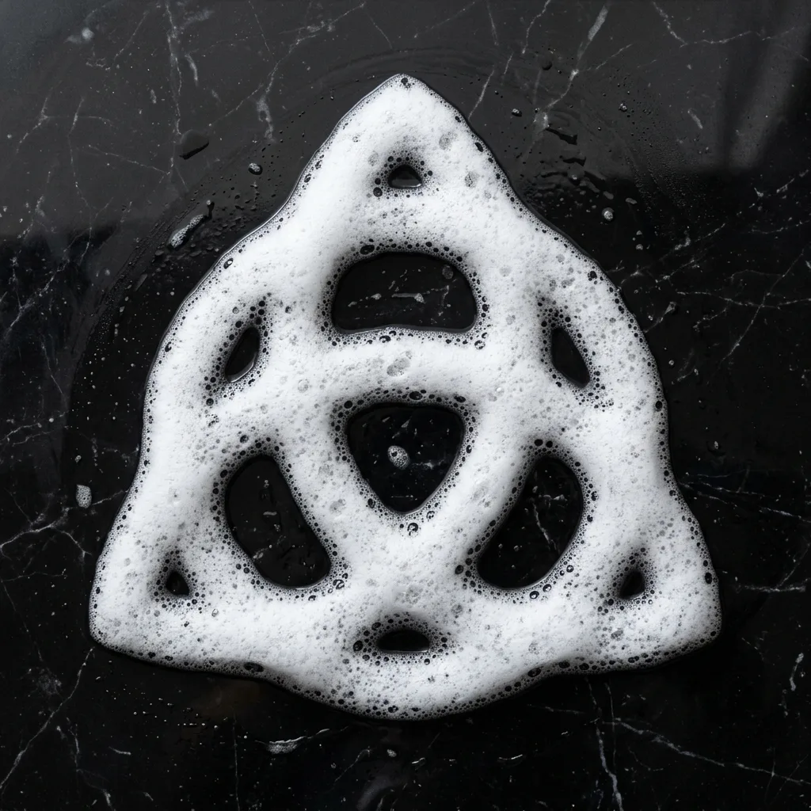

# Top-down photograph of detergent foam forming a precise subject

[← Back to the collection](../../README.md) · Category: [Product & Brand](../../gallery/product-brand.md) · Model: `Vinano Image Pro` · ID: `vn-00709`

<a href="https://vinano.ai?utm_source=github&utm_medium=readme&utm_campaign=awesome-image-video-prompts-updating&utm_content=prompt-page-image"></a>

<sub>Preview generated with <a href="https://vinano.ai?utm_source=github&utm_medium=readme&utm_campaign=awesome-image-video-prompts-updating&utm_content=prompt-page-caption">vinano.ai</a></sub>

## Prompt

```text
Ultra-realistic top-down photograph of detergent foam forming a precise [subject / logo / symbol / shape] on a polished black marble surface. Thick, airy white foam realistic bubbles of varying sizes, natural translucency, wet shine, and soft highlights. Foam appears freshly formed, slightly uneven at the edges, physically accurate, volumetric, and naturally settled on the marble.

Black marble background subtle white veining, glossy finish, realistic reflections and moisture marks, high contrast between white foam and dark stone. Clean refined minimalist composition, centered subject.

Soft diffused overhead lighting creating gentle reflections on the marble and delicate shadows within the foam bubbles. true-to-life photorealistic texture detail, macro-level realism, high-end commercial photography style, no text overlays, no illustrations, no stylization, no CGI look, ultra-clean aesthetic, sharp focus, 8k resolution, 1:1

Preserve realistic proportions and depth for a confident, professional finish.
```

## Try it on vinano.ai

1. Copy the prompt above.
2. Open **[vinano.ai](https://vinano.ai?utm_source=github&utm_medium=readme&utm_campaign=awesome-image-video-prompts-updating&utm_content=prompt-page-try)**, paste it into the image generator and pick a model.
3. Swap any placeholders (brand, product, city, person…) for your own details, then generate.

More prompts like this: [Product & Brand gallery](../../gallery/product-brand.md) · [all categories](../../README.md#contents)
