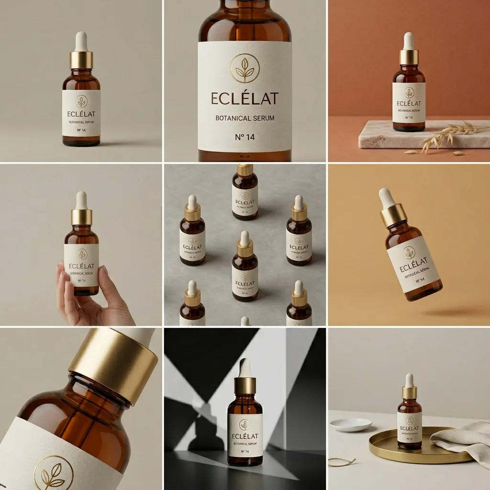

# Un storyboard limpio en cuadrícula 3×3 con nueve paneles

[← Back to the collection](../../README.md) · Category: [Product & Brand](../../gallery/product-brand.md) · Model: `Vinano Image Pro` · ID: `vn-00723`

<a href="https://vinano.ai?utm_source=github&utm_medium=readme&utm_campaign=awesome-image-video-prompts-updating&utm_content=prompt-page-image"></a>

<sub>Preview generated with <a href="https://vinano.ai?utm_source=github&utm_medium=readme&utm_campaign=awesome-image-video-prompts-updating&utm_content=prompt-page-caption">vinano.ai</a></sub>

## Prompt

```text
Un storyboard limpio en cuadrícula 3×3 con nueve paneles iguales en proporción [ratio], dentro de un formato total 4:5.

Usa la de referencia como base del producto. Mantén exactamente el mismo producto, diseño del packaging, branding, materiales, colores, proporciones e identidad general en los nueve paneles, tal como en la referencia. El producto debe ser claramente reconocible en cada frame. La etiqueta, el logo y las proporciones deben permanecer exactamente iguales.

Este storyboard es una presentación mockup de alto nivel para un portfolio de branding. El enfoque está en la forma, la composición, la materialidad y el ritmo visual, más que en el realismo o una narrativa lifestyle. El resultado debe sentirse curado, editorial y orientado al diseño.

FRAME 1:
Plano frontal hero del producto en un entorno de estudio limpio. Fondo neutro, composición equilibrada, presentación calmada y segura del producto.

FRAME 2:
Primer plano con el enfoque centrado en la parte media del producto. Se destacan la textura de la superficie, los materiales y los detalles de impresión.

FRAME 3:
El producto de referencia colocado en un entorno que encaja naturalmente con la marca y la categoría del producto. Escenario de estudio inspirado en los elementos de diseño y colores del producto.

FRAME 4:
Producto mostrado en uso o en interacción sobre un fondo de estudio neutro. Las manos y los elementos de interacción son mínimos y discretos, manteniendo el estilo del packaging.

FRAME 5:
Composición isométrica que muestra varios productos organizados en un orden geométrico preciso desde un ángulo isométrico superior. Todos los productos están colocados con el mismo ángulo isométrico, espaciados de forma uniforme, limpios, estructurados y gráficos.

FRAME 6:
Producto levitando ligeramente, inclinado sobre un fondo neutro que coincida con la paleta de colores de la de referencia. La posición flotante es intencional y natural en el espacio.

FRAME 7:
Primerísimo primer plano centrado en un detalle específico de la etiqueta, el borde, la textura o el comportamiento del material.

FRAME 8:
El producto en un entorno inesperado pero estéticamente potente, con un enfoque audaz, editorial y visualmente impactante. Escenario inesperado pero altamente estilizado, basado en estudio y dirigido por diseño. Composición fuerte que eleva la marca.

FRAME 9:
Composición amplia que muestra el producto en uso dentro de un setup de diseño refinado. Props limpios, estilismo controlado y coherente con el resto de la serie.

CÁMARA Y ESTILO:
Imágenes de estudio de ultra alta calidad con apariencia de cámara real. Diferentes ángulos y encuadres en cada frame. Profundidad de campo controlada, iluminación precisa, materiales y reflejos realistas. La lógica de iluminación, la paleta de colores, el mood y el lenguaje visual deben mantenerse consistentes en los nueve paneles como una sola serie cohesionada.

OUTPUT:
Una cuadrícula limpia 3×3 sin bordes, sin texto, sin captions y sin marcas de agua.

Aim for an editorial, design-driven look with deliberate negative space.
```

## Try it on vinano.ai

1. Copy the prompt above.
2. Open **[vinano.ai](https://vinano.ai?utm_source=github&utm_medium=readme&utm_campaign=awesome-image-video-prompts-updating&utm_content=prompt-page-try)**, paste it into the image generator and pick a model.
3. Swap any placeholders (brand, product, city, person…) for your own details, then generate.

More prompts like this: [Product & Brand gallery](../../gallery/product-brand.md) · [all categories](../../README.md#contents)
