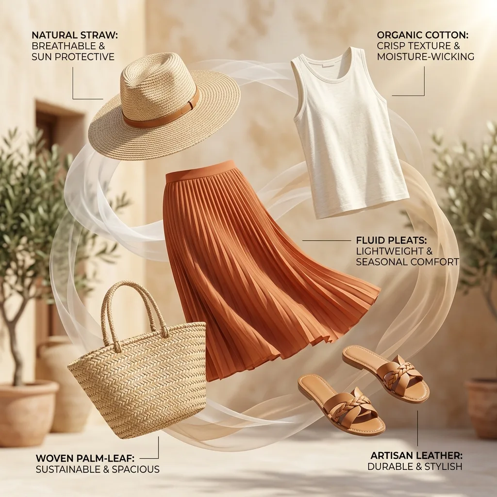

# High-fashion summer outfit infographic color-coordinated floating elements arranged

[← Back to the collection](../../README.md) · Category: [Product & Brand](../../gallery/product-brand.md) · Model: `Vinano Image Pro` · ID: `vn-00724`

<a href="https://vinano.ai?utm_source=github&utm_medium=readme&utm_campaign=awesome-image-video-prompts-updating&utm_content=prompt-page-image"></a>

<sub>Preview generated with <a href="https://vinano.ai?utm_source=github&utm_medium=readme&utm_campaign=awesome-image-video-prompts-updating&utm_content=prompt-page-caption">vinano.ai</a></sub>

## Prompt

```text
High-fashion summer outfit infographic color-coordinated floating elements arranged in an elegant exploded circular composition, featuring a breathable straw hat, sleeveless organic cotton top, fluid pleated skirt, artisan leather sandals, and a woven palm-leaf bag; refined callouts highlight fabric breathability, crisp texture, moisture-wicking, and seasonal comfort, warm neutral tones of ivory, terracotta, sand, and soft tan; subtle motion trails and airy fabric swirls suggest a gentle summer breeze, bright natural sunlight creates soft shadows and a sun-kissed glow, Mediterranean gemini lifestyle mood, premium editorial aesthetic, ultra-sharp details, minimal typography, luxury fashion magazine infographic style, Instagram-ready Preserve realistic proportions and depth for a confident, professional finish.
```

## Try it on vinano.ai

1. Copy the prompt above.
2. Open **[vinano.ai](https://vinano.ai?utm_source=github&utm_medium=readme&utm_campaign=awesome-image-video-prompts-updating&utm_content=prompt-page-try)**, paste it into the image generator and pick a model.
3. Swap any placeholders (brand, product, city, person…) for your own details, then generate.

More prompts like this: [Product & Brand gallery](../../gallery/product-brand.md) · [all categories](../../README.md#contents)
