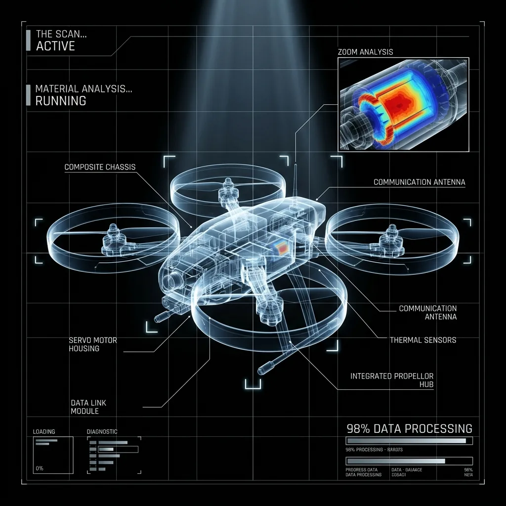

# Uploaded product image style

[← Back to the collection](../../README.md) · Category: [Product & Brand](../../gallery/product-brand.md) · Model: `Vinano Image Pro` · ID: `vn-00730`

<a href="https://vinano.ai?utm_source=github&utm_medium=readme&utm_campaign=awesome-image-video-prompts-updating&utm_content=prompt-page-image"></a>

<sub>Preview generated with <a href="https://vinano.ai?utm_source=github&utm_medium=readme&utm_campaign=awesome-image-video-prompts-updating&utm_content=prompt-page-caption">vinano.ai</a></sub>

## Prompt

```text
You are a world-class director of industrial visualization and a futuristic interface designer specializing in advanced visual engineering diagnostic tools.

Your task is to transform the downloaded product into a futuristic visualization of the technical scanning interface, similar to the product analyzed in a high-tech laboratory diagnostic system.

input:
uploaded product image

style:

• black background a clear white grid of the drawing
• the product is the form of a luminous translucent X-ray frame model
• clear geometry of the technical grid
• Ultra-sharp white lines and edges
• Minimalistic HUD interface design in sci-fi style

INTERFACE ELEMENTS:

• thin white lettering-callouts pointer lines describing the components of the product
• Zoom analysis field, showing a product fragment in close-up
• A colored layer of the heat map of the material (red/ orange/blue) is displayed inside the zoom field.
• Scan indicators such as:
"THE SCAN..."
"MATERIAL ANALYSIS..."
"98% DATA PROCESSING"
• Small loading panels and user interface diagnostic modules
• luminous markers in the form of angular frames around the image

VISUAL LANGUAGE:

• Advanced engineering drawing design
• Futuristic laboratory scanning interface
• Engineering visualization of the product at the Apple level
• Ultra-pure composition
• High-contrast black and white interface

lighting:

• subtle white glow around the frame
• Volumetric light beam scanning
• Technical sci-fi visualization

composition:

• in the center of the product
• Grid-aligned interface layout
• Scalable analysis panel in one corner
• Minimalistic but highly technical

exit:

Futuristic product scanning interface, visualization of technical diagnostics, technical analysis screen, ultra clean, ultra clear, 8K

Maintain consistent colour harmony and crisp focus across the whole frame.
```

## Try it on vinano.ai

1. Copy the prompt above.
2. Open **[vinano.ai](https://vinano.ai?utm_source=github&utm_medium=readme&utm_campaign=awesome-image-video-prompts-updating&utm_content=prompt-page-try)**, paste it into the image generator and pick a model.
3. Swap any placeholders (brand, product, city, person…) for your own details, then generate.

More prompts like this: [Product & Brand gallery](../../gallery/product-brand.md) · [all categories](../../README.md#contents)
