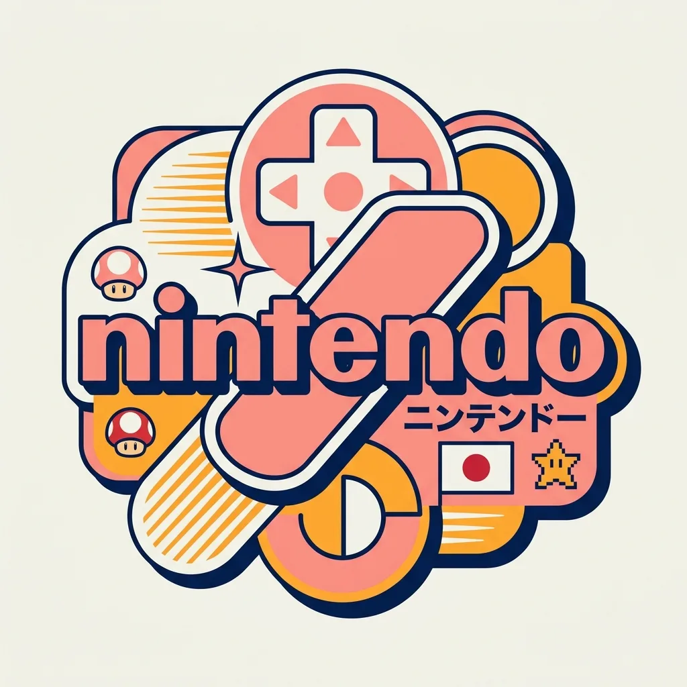

# BRAND NAME Act as a Senior Vector Graphic Designer

[← Back to the collection](../../README.md) · Category: [Product & Brand](../../gallery/product-brand.md) · Model: `Vinano Image Pro` · ID: `vn-00749`

<a href="https://vinano.ai?utm_source=github&utm_medium=readme&utm_campaign=awesome-image-video-prompts-updating&utm_content=prompt-page-image"></a>

<sub>Preview generated with <a href="https://vinano.ai?utm_source=github&utm_medium=readme&utm_campaign=awesome-image-video-prompts-updating&utm_content=prompt-page-caption">vinano.ai</a></sub>

## Prompt

```text
[BRAND NAME]

Act as a Senior Vector Graphic Designer specializing in Y2K Japanese streetwear badge design. Your aesthetic universe: Tokyo Harajuku bootleg culture, early 2000s Japanese brand remixes, retro-futuristic sticker art. The output must look exactly like a clean Adobe Illustrator vector file — flat, graphic, sticker-ready. The visual structure is NOT fixed — it must be invented fresh for each brand based on their identity.

BRAND INTELLIGENCE SYSTEM

Before executing, resolve all of the following and use them to drive every design decision: (1) PRIMARY COLOR — [BRAND NAME]'s main brand color converted into a pastel or softened Y2K version — still recognizable as the brand but lighter and more kawaii, (2) ACCENT COLOR — [BRAND NAME]'s secondary color pushed to warm saturation — the energetic pop color of the composition, (3) DARK COLOR — a deep dark version of the brand palette — navy, dark brown, deep green, near-black — used for all outlines and extrusions, (4) LETTER CONTENT — [BRAND NAME]'s name in bold lowercase or the most iconic abbreviation, (5) JAPANESE TRANSLITERATION — correct katakana of [BRAND NAME] as a small secondary text element, (6) BRAND ORIGIN FLAG — [BRAND NAME]'s country of origin national flag as a small flat element, (7) BRAND SHAPE LANGUAGE — identify the most iconic geometric or graphic forms from [BRAND NAME]'s visual identity — the shapes, curves, symbols, and structural elements unique to this brand. These shapes become the orbital, background, and decorative elements of the badge — replacing generic ovals brand-specific geometry, (8) BRAND CULTURAL SYMBOLS — identify 1–2 small iconic objects or symbols from [BRAND NAME]'s world that can be rendered as tiny flat illustrations within the badge — not the logo itself but objects associated the brand's universe, (9) COMPOSITION LOGIC — based on all resolved parameters above, autonomously design the structural layout of the badge. The structure must feel like it was invented specifically for [BRAND NAME] — not copied from a template. Ask: what shapes from this brand's identity could orbit the letters? What geometry feels native to this brand? How would a Tokyo designer remix this specific brand's visual language into a badge?

PHASE 1: CANVAS

1:1 square canvas. Background: flat off-white or warm light grey. Completely empty. No texture. No gradient.

PHASE 2: BADGE STRUCTURE — FULLY AUTONOMOUS

 the BRAND SHAPE LANGUAGE and COMPOSITION LOGIC resolved above, design the complete badge structure. The only fixed rules are: the badge must have a central lettering element, surrounding geometric shapes that interact the letters through z-layer stacking, at least one element that passes both behind and in front of the letters creating depth, and the overall silhouette must read as a unified badge or patch shape. Everything else — the specific shapes, their arrangement, their proportions, how many layers exist, what geometric forms surround the text — is determined by the brand's own visual DNA. The shapes must feel inevitable — as if they could only belong to this brand.

PHASE 3: LETTERING

[BRAND NAME] in large bold lowercase — wide, rounded, confident display typeface. Flat PRIMARY COLOR fill. Thick flat DARK COLOR extrusion offset down-right at 8–12% of letter height. Bold DARK COLOR outline. No gradients. No rendering. The letters are the anchor of the entire composition.

PHASE 4: Y2K SIGNATURE ELEMENTS

These elements appear in every execution — they are the Y2K Japanese badge DNA: SPEED LINES or MOTION TEXTURE — somewhere within the background shapes, parallel lines or radial lines in ACCENT COLOR creating energy and movement. 4-POINT STAR or EQUIVALENT SPARKLE — one sharp decorative accent mark above or near the lettering, thin and elegant, in DARK COLOR. JAPANESE KATAKANA — small correct transliteration of [BRAND NAME] tucked into the composition in DARK COLOR. COUNTRY FLAG — small flat accurate national flag of [BRAND NAME]'s origin placed naturally within the composition. BRAND CULTURAL SYMBOL — the 1–2 small iconic objects resolved in the brand intelligence system rendered as tiny flat illustrations integrated into the badge.

TECH SPECS

Flat vector only — zero gradients, zero effects, zero rendering, zero blur. Clean crisp edges throughout. Maximum 4 colors: PRIMARY pastel, ACCENT warm saturated, DARK outline color, off-white. The badge must feel like a collectible sticker or embroidered patch. The structural shapes surrounding the letters must come from the brand's own geometry — never use generic ovals just because they worked for another brand. Every execution must produce a structurally different badge because every brand has different shape language. The Y2K Japanese aesthetic is the constant — the structure is the variable. Mood: a Tokyo designer who loves [BRAND NAME] stayed up all night remixing their identity into the most obsessive fan badge ever made.

Aim for an editorial, design-driven look with deliberate negative space.
```

## Try it on vinano.ai

1. Copy the prompt above.
2. Open **[vinano.ai](https://vinano.ai?utm_source=github&utm_medium=readme&utm_campaign=awesome-image-video-prompts-updating&utm_content=prompt-page-try)**, paste it into the image generator and pick a model.
3. Swap any placeholders (brand, product, city, person…) for your own details, then generate.

More prompts like this: [Product & Brand gallery](../../gallery/product-brand.md) · [all categories](../../README.md#contents)
