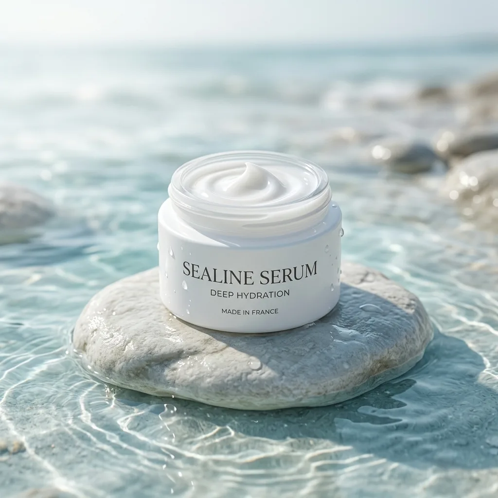

# Premium refined minimalist skincare product photography scene featuring

[← Back to the collection](../../README.md) · Category: [Product & Brand](../../gallery/product-brand.md) · Model: `Vinano Image Pro` · ID: `vn-00764`

<a href="https://vinano.ai?utm_source=github&utm_medium=readme&utm_campaign=awesome-image-video-prompts-updating&utm_content=prompt-page-image"></a>

<sub>Preview generated with <a href="https://vinano.ai?utm_source=github&utm_medium=readme&utm_campaign=awesome-image-video-prompts-updating&utm_content=prompt-page-caption">vinano.ai</a></sub>

## Prompt

```text
{
 "prompt": "A premium refined minimalist skincare product photography scene featuring an open white cosmetic jar labeled 'Sealine Serum'. The jar is placed on a smooth, pale stone partially submerged in crystal-clear shallow water. The cream inside the jar has a soft, glossy swirl a pristine, silky texture. Gentle water ripples surround the stone, creating natural light refractions and caustic patterns on the surface below. Small water droplets and subtle splashes add freshness and motion. The environment feels serene, clean, and natural, evoking purity, hydration, and calm luxury. The color palette is cool and airy, dominated by soft whites, light blues, and stone neutrals. Lighting is bright, diffused daylight soft highlights and minimal shadows, emphasizing texture, moisture, and realism. The composition is centered and balanced, shallow depth of field and a softly blurred background for a high-end cosmetic advertising look. Ultra-realistic, photoreal, editorial-quality product shot.",
 "negative_prompt": "harsh shadows, dirty water, cluttered background, plastic texture, low resolution, oversharpening, unrealistic reflections, strong color cast, text artifacts, watermark, logo distortion, messy cream surface",
 "style": "luxury skincare advertising",
 "camera": {
 "type": "DSLR",
 "lens": "90mm macro",
 "aperture": "f/5.6",
 "iso": 100,
 "shutter_speed": "1/250"
 },
 "lighting": {
 "type": "natural diffused daylight",
 "direction": "top and side",
 "contrast": "low to medium",
 "temperature": "cool-neutral"
 },
 "composition": {
 "framing": "centered product focus",
 "angle": "slightly elevated",
 "orientation": "portrait",
 "depth_of_field": "shallow soft background blur"
 },
 "quality": {
 "resolution": "8K",
 "detail": "ultra-fine texture detail",
 "sharpness": "high",
 "realism": "true-to-life photorealistic"
 }
}

Aim for an editorial, design-driven look with deliberate negative space.
```

## Try it on vinano.ai

1. Copy the prompt above.
2. Open **[vinano.ai](https://vinano.ai?utm_source=github&utm_medium=readme&utm_campaign=awesome-image-video-prompts-updating&utm_content=prompt-page-try)**, paste it into the image generator and pick a model.
3. Swap any placeholders (brand, product, city, person…) for your own details, then generate.

More prompts like this: [Product & Brand gallery](../../gallery/product-brand.md) · [all categories](../../README.md#contents)
