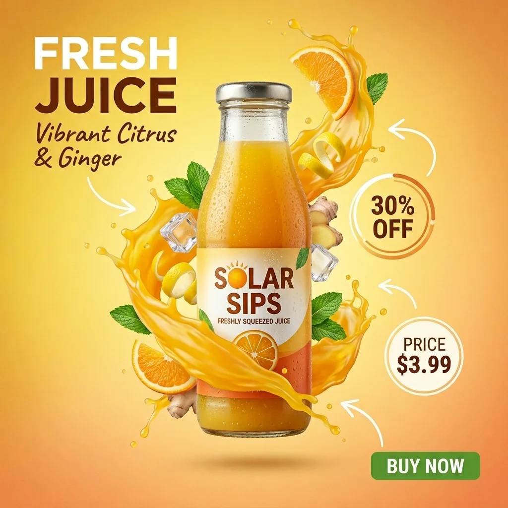

# Product & Brand prompt #766

[← Back to the collection](../../README.md) · Category: [Product & Brand](../../gallery/product-brand.md) · Model: `Vinano Image Pro` · ID: `vn-00766`

<a href="https://vinano.ai?utm_source=github&utm_medium=readme&utm_campaign=awesome-image-video-prompts-updating&utm_content=prompt-page-image"></a>

<sub>Preview generated with <a href="https://vinano.ai?utm_source=github&utm_medium=readme&utm_campaign=awesome-image-video-prompts-updating&utm_content=prompt-page-caption">vinano.ai</a></sub>

## Prompt

```text
Exact uploaded [BOTTLE_NAME] bottle (label unchanged). Vertical poster. Center bottle w/ condensation. Add [JUICE_COLOR] liquid splash wrap + ice cubes + [INGREDIENTS] floating (controlled). Background: [BG_COLOR] gradient + vignette + grain.
Top-left: “FRESH JUICE” + “[FLAVOR_TAGLINE]”. Right: circular “30% OFF” ring. Lower-right: price circle “[PRICE]”. Bottom-right CTA “[CTA]”. White doodle arrows. Studio key+rim, 85mm, sharp text, no watermark.

Preserve realistic proportions and depth for a confident, professional finish.
```

## Try it on vinano.ai

1. Copy the prompt above.
2. Open **[vinano.ai](https://vinano.ai?utm_source=github&utm_medium=readme&utm_campaign=awesome-image-video-prompts-updating&utm_content=prompt-page-try)**, paste it into the image generator and pick a model.
3. Swap any placeholders (brand, product, city, person…) for your own details, then generate.

More prompts like this: [Product & Brand gallery](../../gallery/product-brand.md) · [all categories](../../README.md#contents)
