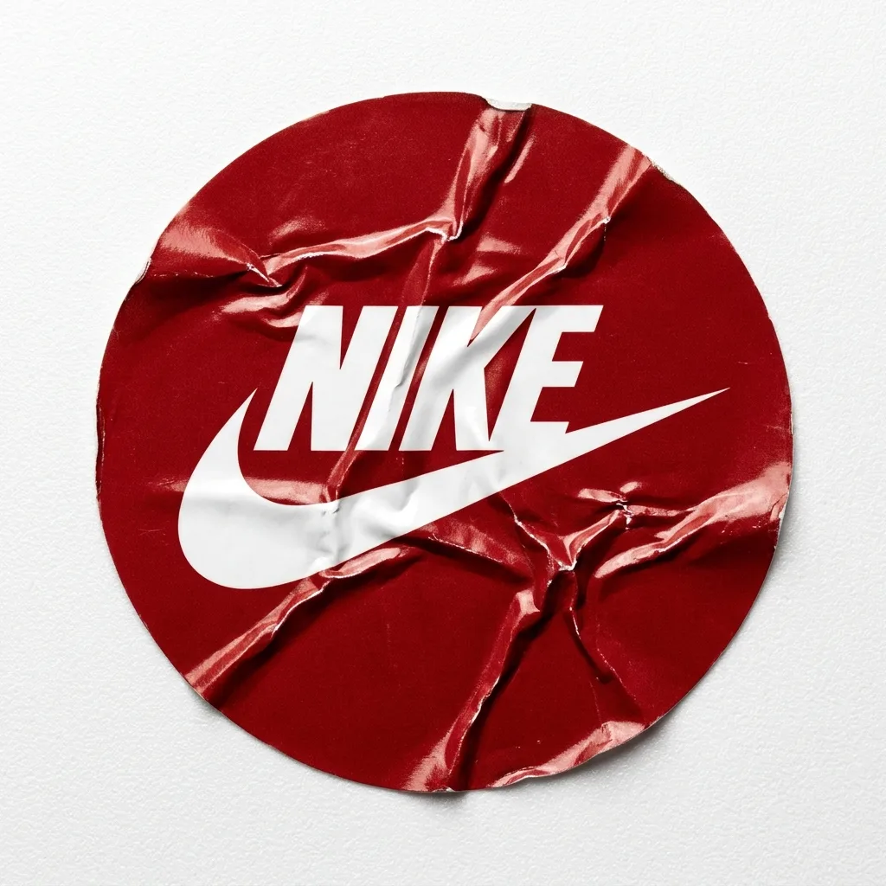

# Sharp, top-down macro photograph of a single, heavily crumpled

[← Back to the collection](../../README.md) · Category: [Product & Brand](../../gallery/product-brand.md) · Model: `Vinano Image Pro` · ID: `vn-00777`

<a href="https://vinano.ai?utm_source=github&utm_medium=readme&utm_campaign=awesome-image-video-prompts-updating&utm_content=prompt-page-image"></a>

<sub>Preview generated with <a href="https://vinano.ai?utm_source=github&utm_medium=readme&utm_campaign=awesome-image-video-prompts-updating&utm_content=prompt-page-caption">vinano.ai</a></sub>

## Prompt

```text
A sharp, top-down macro photograph of a single,
heavily crumpled circular vinyl sticker featuring the official [BRAND NAME] logo.

MATERIAL & TEXTURE (VINYL):
The sticker is made of durable, slight-gloss vinyl material, not paper. It is severely crinkled sharp, defined ridges and deep stress folds across its entire surface. Unlike soft paper creases, these vinyl wrinkles show plastic stress and catch the light subtle specular highlights on the peaks of the folds. The edges are slightly curled from wear.
COLOR PALETTE (BRAND DYNAMIC):
The background color of the circular sticker itself is the dominant primary color associated [BRAND NAME]'s official brand palette (e.g., if Ferrari, red; if John Deere, green). The logo is printed clearly in its standard contrasting color (e.g., white or black).
LIGHTING (STUDIO BRIGHT):
Bright, clean, high-key overhead white studio lighting. This intense lighting creates strong, clean highlights on the vinyl's crumpled ridges and defined, crisp shadows in the valleys, dramatically emphasizing the 3D topography of the damage.
BACKGROUND & COMPOSITION:
The camera is locked in a strict, perfectly parallel top-down flat lay view. The sticker is adhered flat onto a pure white plastic surface which has a subtle, fine granular texture (like bead-blasted plastic) to provide tactile contrast to the smooth vinyl. The entire sticker is in sharp focus.

Maintain consistent colour harmony and crisp focus across the whole frame.
```

## Try it on vinano.ai

1. Copy the prompt above.
2. Open **[vinano.ai](https://vinano.ai?utm_source=github&utm_medium=readme&utm_campaign=awesome-image-video-prompts-updating&utm_content=prompt-page-try)**, paste it into the image generator and pick a model.
3. Swap any placeholders (brand, product, city, person…) for your own details, then generate.

More prompts like this: [Product & Brand gallery](../../gallery/product-brand.md) · [all categories](../../README.md#contents)
