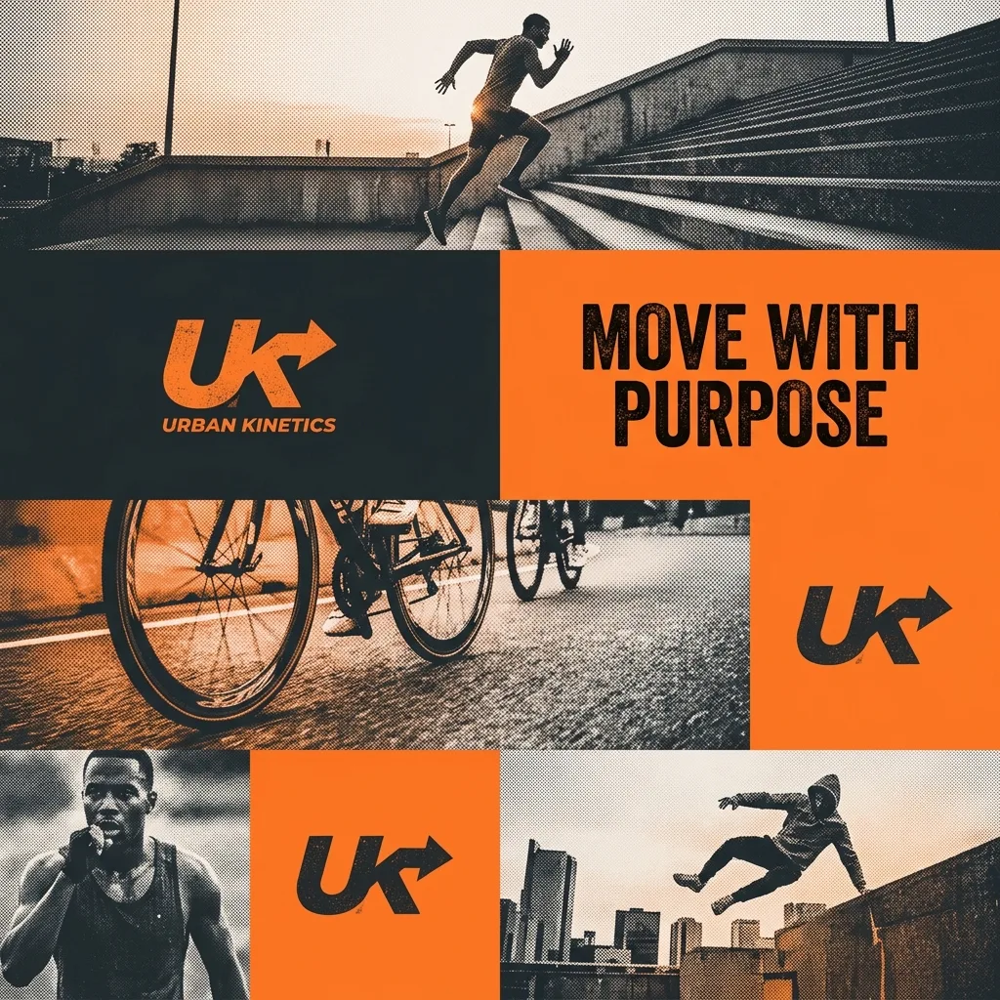

# Product & Brand prompt #778

[← Back to the collection](../../README.md) · Category: [Product & Brand](../../gallery/product-brand.md) · Model: `Vinano Image Pro` · ID: `vn-00778`

<a href="https://vinano.ai?utm_source=github&utm_medium=readme&utm_campaign=awesome-image-video-prompts-updating&utm_content=prompt-page-image"></a>

<sub>Preview generated with <a href="https://vinano.ai?utm_source=github&utm_medium=readme&utm_campaign=awesome-image-video-prompts-updating&utm_content=prompt-page-caption">vinano.ai</a></sub>

## Prompt

```text
[BRAND NAME].
Act as a graphic design creative director constructing a highly structured "Campaign Visual Identity Grid."

COMPOSITION (SPECIFIC 2-COLUMN ASYMMETRICAL LAYOUT):

The image must follow a strict 2-column grid structure, exactly like the layout seen in professional campaign boards.

LAYOUT STRUCTURE (TOP TO BOTTOM):
ROW 1: One single, full-width rectangular block (e.g., a wide photo).
ROW 2: Two equal-sized square blocks side-by-side.
ROW 3: One single, full-width rectangular block
ROW 4: Two equal-sized square blocks side-by-side.
ROW 5: One single, full-width rectangular block at the bottom.
The grid must be perfectly stable, all blocks forming this exact pattern.

CRITICAL CONSTRAINTS:
FULL BLEED (100% COVERAGE): The grid must occupy the ENTIRE canvas area from edge to edge. There are absolutely NO margins, NO borders, and NO background space visible.

ZERO SPACING (NO GAPS): The grid tiles must be seamlessly abutted. There should be absolutely NO gutters, white lines, or spacing between the blocks. They must touch perfectly to form a solid wall.

GLOBAL RULES:
Typography: Use ONLY ONE font.
Uniqueness: Every photo cell must be UNIQUE. No duplicates.

THE GRID CONTENT & SPECIFIC TEXTURES (3 TYPES):
Distribute these three block types rhythmically throughout the specific 2-column layout defined above:

TYPE A: THE LOGO BLOCK (PRINT GRUNGE):
A solid block in the brand's primary color containing ONLY the official [BRAND NAME] logomark centered.
Texture: Distressed screen-print texture slight ink bleed and grunge noise.

TYPE B: THE SLOGAN BLOCK (PRINT GRUNGE):

A solid block in a contrasting brand color containing ONLY the official [BRAND NAME] slogan.
Texture: Heavy distressed ink texture and grunge print effects on typography and fill.

TYPE C: CAMPAIGN PHOTOGRAPHY (HALFTONE):
High-contrast B&W action shots or portraits relevant to the brand.

Texture: Apply strong halftone dot patterns (raster dots) and heavy film grain. Use "Multiply" color blending to wash the photos in the brand's specific color palette (duotone effect).

Preserve realistic proportions and depth for a confident, professional finish.
```

## Try it on vinano.ai

1. Copy the prompt above.
2. Open **[vinano.ai](https://vinano.ai?utm_source=github&utm_medium=readme&utm_campaign=awesome-image-video-prompts-updating&utm_content=prompt-page-try)**, paste it into the image generator and pick a model.
3. Swap any placeholders (brand, product, city, person…) for your own details, then generate.

More prompts like this: [Product & Brand gallery](../../gallery/product-brand.md) · [all categories](../../README.md#contents)
