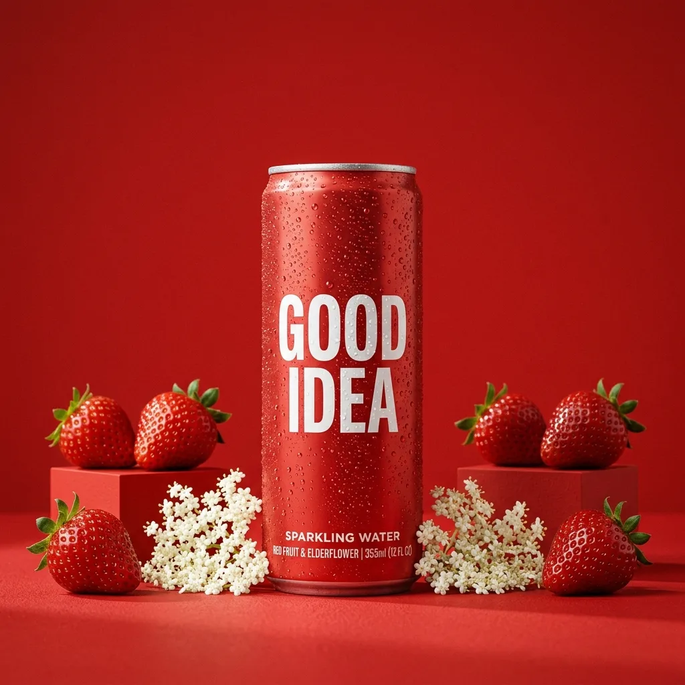

# Premium studio product photograph of a tall, slim red

[← Back to the collection](../../README.md) · Category: [Product & Brand](../../gallery/product-brand.md) · Model: `Vinano Image Pro` · ID: `vn-00786`

<a href="https://vinano.ai?utm_source=github&utm_medium=readme&utm_campaign=awesome-image-video-prompts-updating&utm_content=prompt-page-image"></a>

<sub>Preview generated with <a href="https://vinano.ai?utm_source=github&utm_medium=readme&utm_campaign=awesome-image-video-prompts-updating&utm_content=prompt-page-caption">vinano.ai</a></sub>

## Prompt

```text
A premium studio product photograph of a tall, slim red aluminum sparkling water can standing upright and centered against a seamless vivid red background, the can covered in fine condensation droplets crisp white typography reading “GOOD IDEA” and smaller flavor text beneath, positioned on a matte red surface subtle reflections, surrounded symmetrically by fresh ripe strawberries glossy seeds and deep red flesh, some resting directly on the surface and others placed on small red rectangular blocks to the left and right, delicate white elderflower blossoms scattered between the fruit for contrast, the lighting soft yet directional from the upper left creating gentle highlights on the can's metallic texture and soft shadows beneath the fruit, the color palette dominated by saturated reds clean white accents and natural green stems, the composition minimal and perfectly balanced generous negative space above the product, shallow depth of field, ultra-sharp focus on the can, high-end commercial aesthetic, true-to-life photorealistic, studio-grade, cinematic realism. Maintain consistent colour harmony and crisp focus across the whole frame.
```

## Try it on vinano.ai

1. Copy the prompt above.
2. Open **[vinano.ai](https://vinano.ai?utm_source=github&utm_medium=readme&utm_campaign=awesome-image-video-prompts-updating&utm_content=prompt-page-try)**, paste it into the image generator and pick a model.
3. Swap any placeholders (brand, product, city, person…) for your own details, then generate.

More prompts like this: [Product & Brand gallery](../../gallery/product-brand.md) · [all categories](../../README.md#contents)
