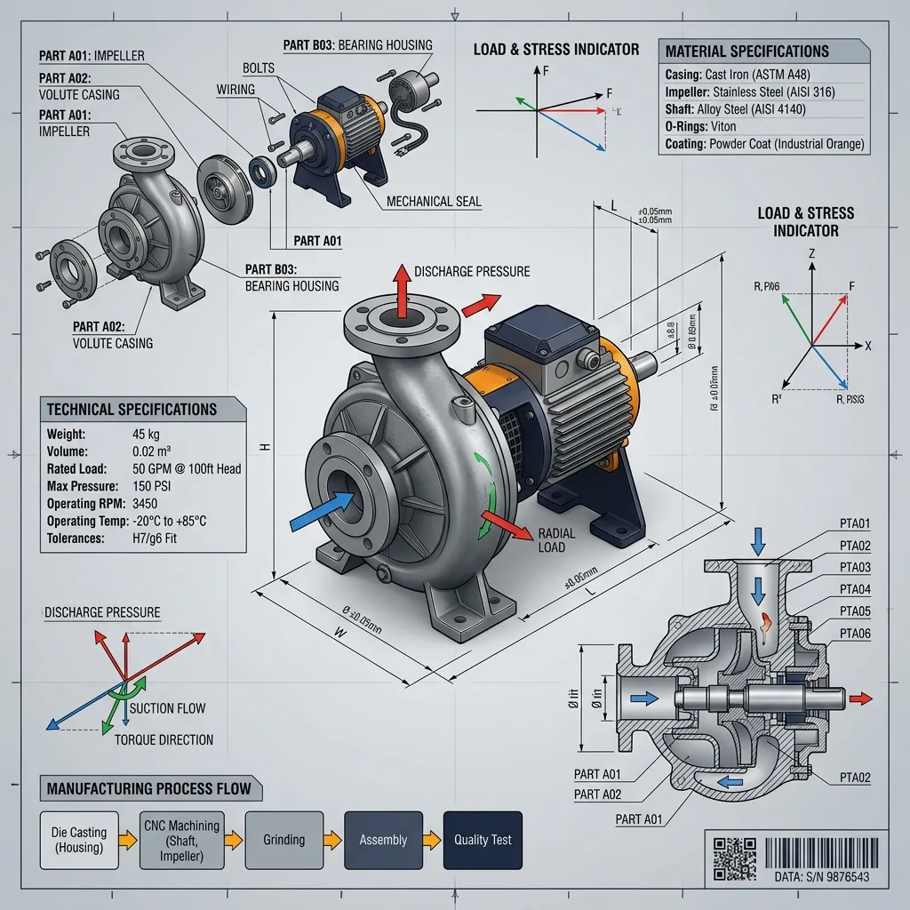

# Product & Brand prompt #812

[← Back to the collection](../../README.md) · Category: [Product & Brand](../../gallery/product-brand.md) · Model: `Vinano Image Pro` · ID: `vn-00812`

<a href="https://vinano.ai?utm_source=github&utm_medium=readme&utm_campaign=awesome-image-video-prompts-updating&utm_content=prompt-page-image"></a>

<sub>Preview generated with <a href="https://vinano.ai?utm_source=github&utm_medium=readme&utm_campaign=awesome-image-video-prompts-updating&utm_content=prompt-page-caption">vinano.ai</a></sub>

## Prompt

```text
Industrial engineering-style infographic of an object (match exactly the object from the uploaded photo reference).
Ultra-precise technical rendering of the object placed at the center, accurate proportions, textures, materials, and surface details identical to the reference photo.
Surround the object industrial–grade technical elements:
• Blueprint-inspired dimension lines (length, width, height, radius, angle, tolerances).
• Cross-section cutaway view revealing internal components engineering hatching patterns.
• Exploded-view assembly diagram showing bolts, brackets, joints, wiring, bearings, or internal mechanisms.
• Material specification blocks (steel type, plastics, alloys, coatings, finishes).
• Process flow arrows describing manufacturing steps (CNC, casting, welding, injection, stamping).
• Load & stress indicator graphics arrows, vector force diagrams, thermal flow, or torque direction.
• Part numbering following industrial annotation style (Part A01, A02, etc).
• Tech data panels like: weight, volume, tolerances, rated load, pressure, RPM, operating temperature.
• QR-style data block or barcode element for extra industrial feel.
Design style:
• clean, structured, engineering-oriented layout
• color palette of steel grey, dark navy, orange/yellow safety accents
• background like a technical drafting sheet or industrial metal texture (subtle, not distracting)
• sharp sans-serif typeface actual engineering annotation style
• shadows minimal, prioritizing clarity and precision
Overall vibe: serius, presisi, manufaktur-grade, seperti poster teknik pabrik atau katalog industrial tooling.
Aspect Ratio: 9:16

Preserve realistic proportions and depth for a confident, professional finish.
```

## Try it on vinano.ai

1. Copy the prompt above.
2. Open **[vinano.ai](https://vinano.ai?utm_source=github&utm_medium=readme&utm_campaign=awesome-image-video-prompts-updating&utm_content=prompt-page-try)**, paste it into the image generator and pick a model.
3. Swap any placeholders (brand, product, city, person…) for your own details, then generate.

More prompts like this: [Product & Brand gallery](../../gallery/product-brand.md) · [all categories](../../README.md#contents)
