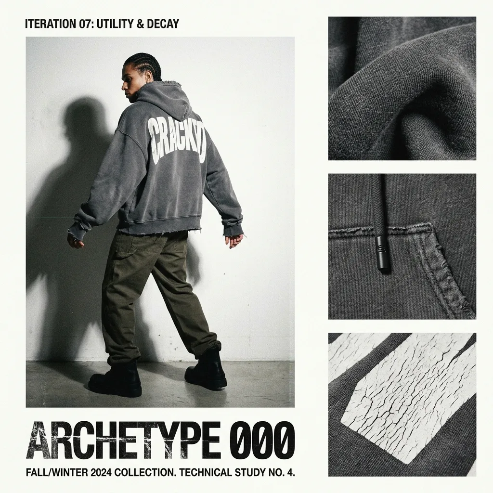

# Product & Brand prompt #815

[← Back to the collection](../../README.md) · Category: [Product & Brand](../../gallery/product-brand.md) · Model: `Vinano Image Pro` · ID: `vn-00815`

<a href="https://vinano.ai?utm_source=github&utm_medium=readme&utm_campaign=awesome-image-video-prompts-updating&utm_content=prompt-page-image"></a>

<sub>Preview generated with <a href="https://vinano.ai?utm_source=github&utm_medium=readme&utm_campaign=awesome-image-video-prompts-updating&utm_content=prompt-page-caption">vinano.ai</a></sub>

## Prompt

```text
[BRAND NAME]. Act as a Creative Director and Brand Strategist.

PHASE 1: CONCEPT & COMPOSITION.

Create a multi-panel fashion lookbook collage (grid layout) on a clean off-white background.

- Main Shot: A full-body editorial pose of a model wearing a signature [BRAND NAME] piece.

- Detail Shots: 3-4 smaller rectangular frames showing macro crops of fabric, hardware, and stitching.

- Autonomously determine the garment type based on the brand's current hype items.

PHASE 2: VISUAL STYLE & TEXTURE.

"High-End Lo-fi" aesthetic. Intense film grain, analog noise, and scanline artifacts. Heavy, premium clothing textures: faded vintage washes, distressed edges, and premium-quality "cracked" screen prints. Muted, moody color palette brand-specific accents.

PHASE 3: DYNAMIC TYPOGRAPHY & LOGIC.

Autonomously analyze the [BRAND NAME] heritage and core identity to generate unique typography.

- Content: Instead of generic "Drop" labels, generate text based on the brand’s DNA:

- Style: Match the font to the brand's era (e.g., brutalist sans-serif for modern labels, elegant serif for luxury house heritage). Integrate the [BRAND NAME] logo a distressed, "Xerox-copied" texture.

TECH SPECS:

35mm film look (Kodak Portra 400), f/5.6 for raw sharpness, high ISO grain. High-contrast editorial flash, deep shadows. Octane render quality an analog scan soul.

Aim for an editorial, design-driven look with deliberate negative space.
```

## Try it on vinano.ai

1. Copy the prompt above.
2. Open **[vinano.ai](https://vinano.ai?utm_source=github&utm_medium=readme&utm_campaign=awesome-image-video-prompts-updating&utm_content=prompt-page-try)**, paste it into the image generator and pick a model.
3. Swap any placeholders (brand, product, city, person…) for your own details, then generate.

More prompts like this: [Product & Brand gallery](../../gallery/product-brand.md) · [all categories](../../README.md#contents)
