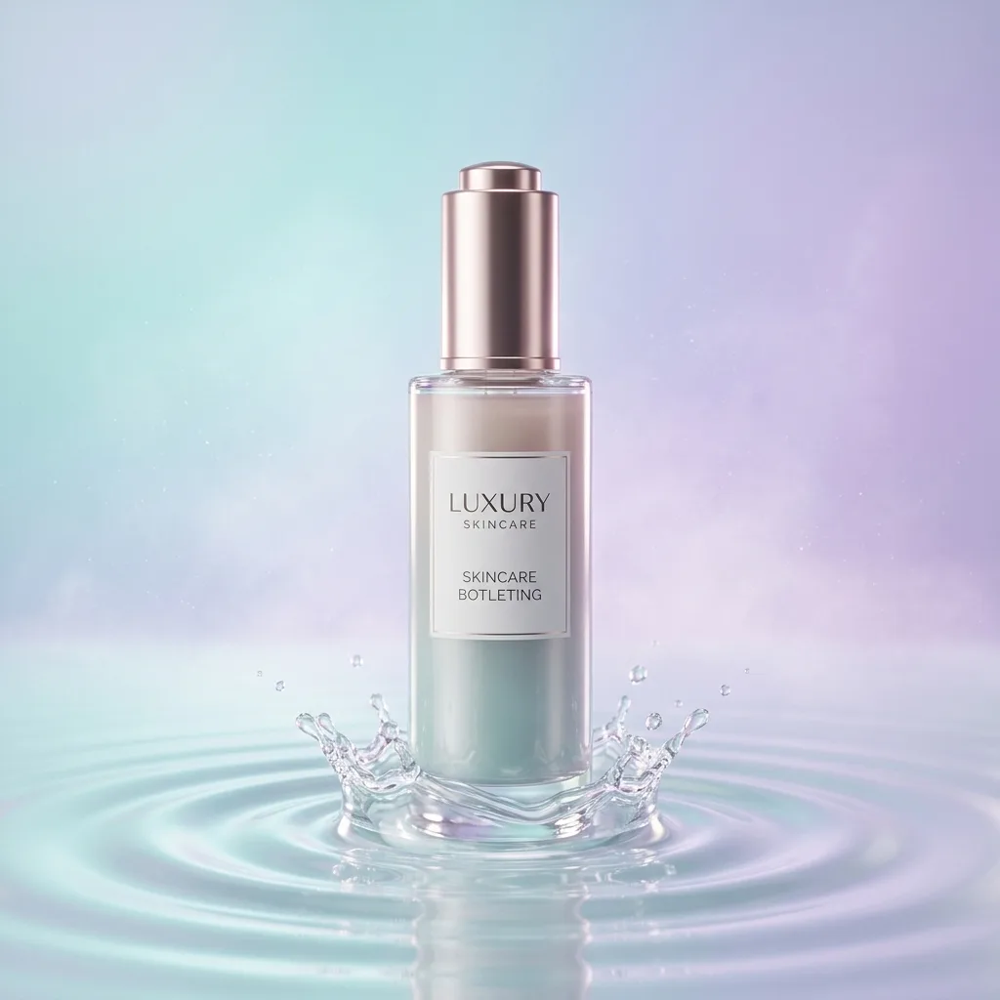

# Luxury skincare commercial, ultra-premium aesthetic

[← Back to the collection](../../README.md) · Category: [Product & Brand](../../gallery/product-brand.md) · Model: `Vinano Image Pro` · ID: `vn-00833`

<a href="https://vinano.ai?utm_source=github&utm_medium=readme&utm_campaign=awesome-image-video-prompts-updating&utm_content=prompt-page-image"></a>

<sub>Preview generated with <a href="https://vinano.ai?utm_source=github&utm_medium=readme&utm_campaign=awesome-image-video-prompts-updating&utm_content=prompt-page-caption">vinano.ai</a></sub>

## Prompt

```text
Luxury skincare commercial, ultra-premium aesthetic. Use the provided product image as the exact reference for bottle shape, label design, liquid tone, reflections, and overall styling.

The bottle stands perfectly upright at the center of the frame, surrounded by a glossy liquid surface smooth, elegant ripples. Soft fluid splashes form a graceful crown around the base, catching light like crystal. Background is a dreamy pastel aqua-to-soft lavender gradient a silky, creamy atmosphere and subtle mist particles floating in the air.

Camera motion:
Slow, continuous 360-degree cinematic orbit around the product. Movement is smooth, controlled, and hypnotic. Constant speed throughout. No shaking, no zooming, no speed changes. The product remains perfectly centered and stable at all times.

Framing:
Mid close-up beauty shot. Bottle remains vertical and motionless, hero focus.

Lighting:
High-end studio lighting, soft diffused glow gentle highlights and glossy reflections. Subtle rim light to outline the bottle. Liquid and glass look luminous, hydrated, and silky.

Mood & style:
Sensual, elegant, and premium beauty campaign. Smooth motion, glossy textures, soft reflections, cinematic depth of field, slow-motion feel, luxury skincare advertisement, 4K true-to-life photorealistic, polished commercial look.

Emphasise material texture and natural light so the final frame feels tactile and premium.
```

## Try it on vinano.ai

1. Copy the prompt above.
2. Open **[vinano.ai](https://vinano.ai?utm_source=github&utm_medium=readme&utm_campaign=awesome-image-video-prompts-updating&utm_content=prompt-page-try)**, paste it into the image generator and pick a model.
3. Swap any placeholders (brand, product, city, person…) for your own details, then generate.

More prompts like this: [Product & Brand gallery](../../gallery/product-brand.md) · [all categories](../../README.md#contents)
