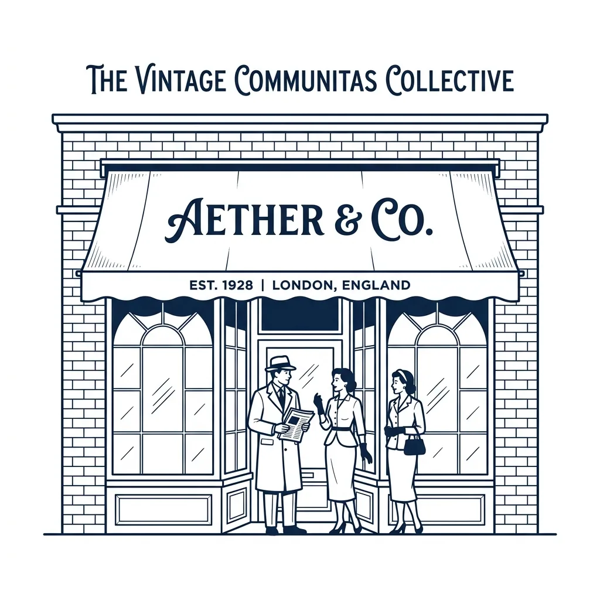

# Product & Brand prompt #839

[← Back to the collection](../../README.md) · Category: [Product & Brand](../../gallery/product-brand.md) · Model: `Vinano Image Pro` · ID: `vn-00839`

<a href="https://vinano.ai?utm_source=github&utm_medium=readme&utm_campaign=awesome-image-video-prompts-updating&utm_content=prompt-page-image"></a>

<sub>Preview generated with <a href="https://vinano.ai?utm_source=github&utm_medium=readme&utm_campaign=awesome-image-video-prompts-updating&utm_content=prompt-page-caption">vinano.ai</a></sub>

## Prompt

```text
[BRAND NAME] | [SUBJECT_TOGGLE]. Act as a Lead Graphic Designer.

PHASE 1: ARCHITECTURAL SETTING.

Create a refined minimalist 2D vector illustration of a vintage-style storefront representing [BRAND NAME].

- Autonomously design the facade (Modernist, Industrial, or Classic) to match the brand's heritage.

PHASE 2: SUBJECT LOGIC (TOGGLE SYSTEM).

- If [SUBJECT_TOGGLE] is "OFF": Show only the empty storefront.

- If [SUBJECT_TOGGLE] is "ON": Autonomously add 1-2 characters or a pet that fits the brand's lifestyle.

PHASE 3: DYNAMIC TYPOGRAPHY (CORRECTED).

- Header: Autonomously generate a high-status "Club" or "Community" title based on the nature of [BRAND NAME]. * Examples: For Starbucks — "Coffee Roasters Society"; for Nike — "Elite Runners Club"; for Apple — "Digital Creators Guild".

- Branding: Place the [BRAND NAME] logo clearly on the storefront awning.

- Contextual Info: Below the awning, add "EST. [REAL FOUNDING YEAR]" and "[REAL ORIGIN CITY]".

PHASE 4: VISUAL STYLE.

- Two-tone palette: [BRAND SIGNATURE COLOR] on a pure white background.

- Style: 1950s-60s Retro Line Art. No gradients, no shadows.

TECH SPECS:

Flat 2D vector, 8k resolution, monochrome aesthetic, centered composition.

Emphasise material texture and natural light so the final frame feels tactile and premium.
```

## Try it on vinano.ai

1. Copy the prompt above.
2. Open **[vinano.ai](https://vinano.ai?utm_source=github&utm_medium=readme&utm_campaign=awesome-image-video-prompts-updating&utm_content=prompt-page-try)**, paste it into the image generator and pick a model.
3. Swap any placeholders (brand, product, city, person…) for your own details, then generate.

More prompts like this: [Product & Brand gallery](../../gallery/product-brand.md) · [all categories](../../README.md#contents)
