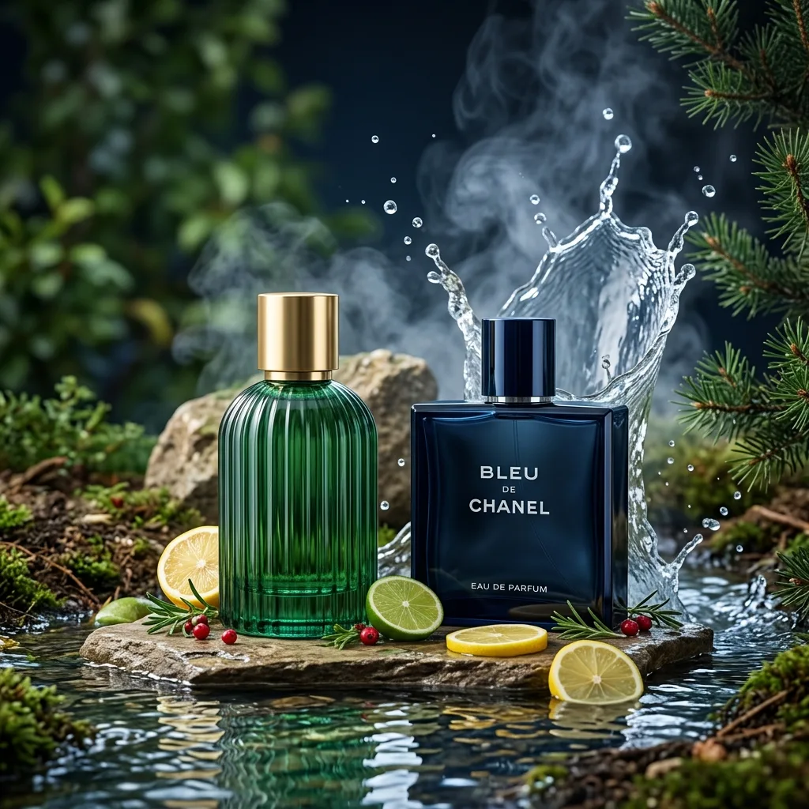

# 3:4 , style

[← Back to the collection](../../README.md) · Category: [Product & Brand](../../gallery/product-brand.md) · Model: `Vinano Image Pro` · ID: `vn-00848`

<a href="https://vinano.ai?utm_source=github&utm_medium=readme&utm_campaign=awesome-image-video-prompts-updating&utm_content=prompt-page-image"></a>

<sub>Preview generated with <a href="https://vinano.ai?utm_source=github&utm_medium=readme&utm_campaign=awesome-image-video-prompts-updating&utm_content=prompt-page-caption">vinano.ai</a></sub>

## Prompt

```text
{
 "global_settings": {
 "resolution": "8K",
 "aspect_ratio": "3:4",
 "style": "true-to-life photorealistic cinematic product photography",
 "detail_level": "extreme micro-detail",
 "sharpness": "ultra-sharp",
 "noise": "none",
 "compression_artifacts": "none",
 "color_depth": "rich 16-bit color",
 "render_quality": "luxury commercial grade",
 "ai_finish": "clean AI-enhanced realism"
 },

 "module_1": {
 "scene_identity": "forest_green_perfume",
 "environment": {
 "setting": "dense forest atmosphere",
 "background": "soft blurred green foliage depth separation",
 "foreground": "natural forest floor soil, moss, and small debris",
 "props": ["flat natural stone platform",
 "irregular rock placed slightly behind the bottle",
 "pine tree branches visible needles on the right side"],
 "atmosphere": "soft drifting smoke or mist rising behind the bottle"
 },
 "product": {
 "object_type": "perfume bottle",
 "material": "ribbed translucent glass",
 "color": "deep emerald green liquid",
 "shape": "cylindrical vertical grooves",
 "cap": {
 "material": "metal",
 "finish": "polished gold",
 "shape": "smooth cylindrical"
 },
 "label": "no visible branding text"
 },
 "lighting": {
 "key_light": "soft diffused natural light from front-left",
 "fill_light": "subtle ambient forest light",
 "highlights": "gentle reflections on glass ribs and gold cap",
 "shadows": "soft realistic shadows under bottle and rocks"
 },
 "camera": {
 "angle": "eye-level product angle",
 "focus": "sharp focus on bottle, shallow depth of field",
 "lens_effect": "natural bokeh background"
 },
 "mood": "fresh, woody, calm, premium, nature-inspired"
 },

 "module_2": {
 "scene_identity": "blue_water_splash_perfume",
 "environment": {
 "setting": "dark aquatic studio scene",
 "background": "deep navy to black gradient",
 "surface": "rippling water reflective highlights",
 "motion_elements": ["large upward water splash behind bottle",
 "floating water droplets suspended mid-air"],
 "props": ["lemon slices (yellow flesh visible)",
 "green citrus slice",
 "small red berries",
 "green herb sprigs"]
 },
 "product": {
 "object_type": "perfume bottle",
 "material": "opaque glass",
 "color": "deep midnight blue",
 "shape": "rectangular sharp edges",
 "cap": {
 "material": "matching dark glass",
 "shape": "cylindrical"
 },
 "text_visible": ["BLEU DE CHANEL",
 "EAU DE PARFUM"]
 },
 "lighting": {
 "key_light": "strong directional light from upper front",
 "rim_light": "cool highlights on water splash",
 "reflections": "specular highlights on glass and water surface"
 },
 "camera": {
 "angle": "slightly tilted dynamic angle",
 "focus": "sharp on bottle and splash",
 "motion_freeze": "high-speed capture look"
 },
 "mood": "fresh, energetic, aquatic, luxury fragrance ad"
 }

Preserve realistic proportions and depth for a confident, professional finish.
```

## Try it on vinano.ai

1. Copy the prompt above.
2. Open **[vinano.ai](https://vinano.ai?utm_source=github&utm_medium=readme&utm_campaign=awesome-image-video-prompts-updating&utm_content=prompt-page-try)**, paste it into the image generator and pick a model.
3. Swap any placeholders (brand, product, city, person…) for your own details, then generate.

More prompts like this: [Product & Brand gallery](../../gallery/product-brand.md) · [all categories](../../README.md#contents)
