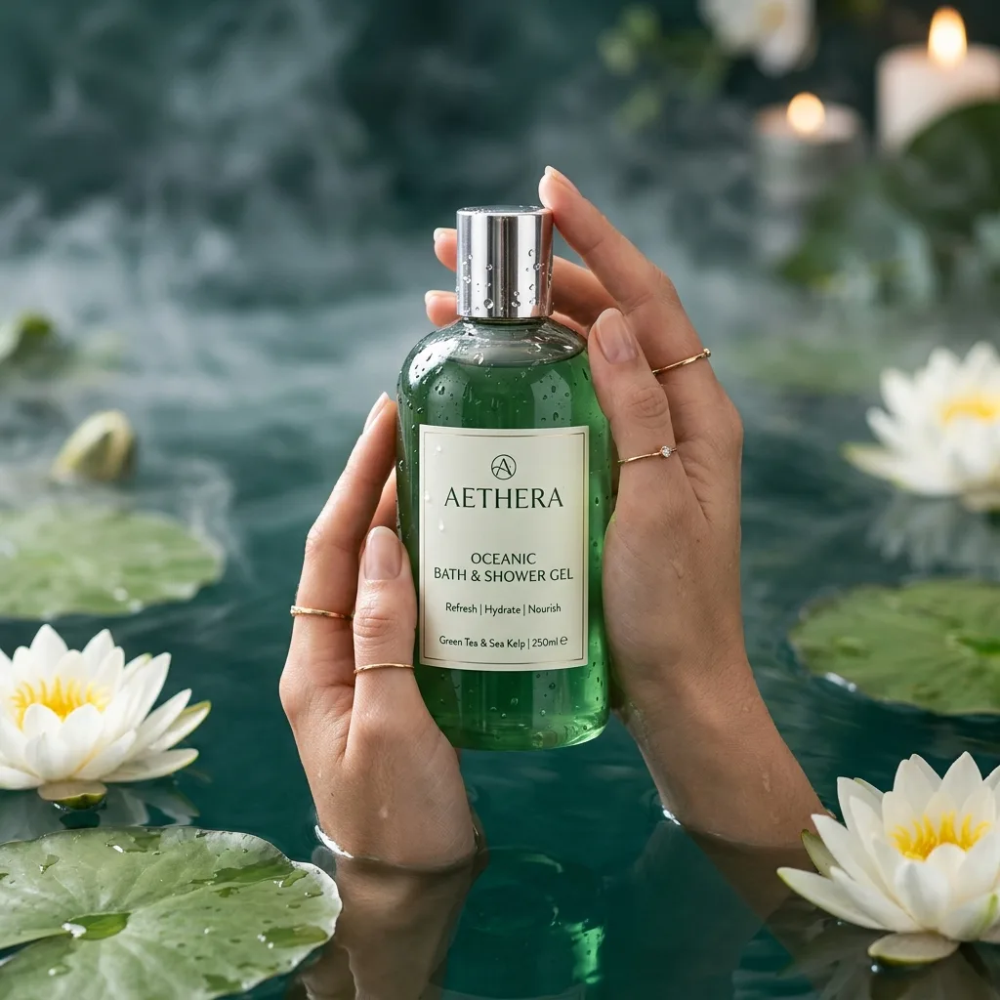

# Luxury product photography of a green translucent bath

[← Back to the collection](../../README.md) · Category: [Product & Brand](../../gallery/product-brand.md) · Model: `Vinano Image Pro` · ID: `vn-00861`

<a href="https://vinano.ai?utm_source=github&utm_medium=readme&utm_campaign=awesome-image-video-prompts-updating&utm_content=prompt-page-image"></a>

<sub>Preview generated with <a href="https://vinano.ai?utm_source=github&utm_medium=readme&utm_campaign=awesome-image-video-prompts-updating&utm_content=prompt-page-caption">vinano.ai</a></sub>

## Prompt

```text
Luxury product photography of a green translucent bath and shower gel bottle held gently by two feminine hands submerged in calm water. The bottle is centered, glossy, water droplets on the surface, silver metallic cap, elegant minimal label design. The water is deep teal-green soft mist swirling across the surface. White lotus flowers and large green lily pads float around the hands. The hands wear delicate thin gold rings. Soft, diffused natural lighting, moody spa atmosphere, high-end skincare advertisement style, ultra-realistic, cinematic composition, shallow depth of field, 85mm lens, high resolution, editorial beauty shot, serene and calming aesthetic. Preserve realistic proportions and depth for a confident, professional finish.
```

## Try it on vinano.ai

1. Copy the prompt above.
2. Open **[vinano.ai](https://vinano.ai?utm_source=github&utm_medium=readme&utm_campaign=awesome-image-video-prompts-updating&utm_content=prompt-page-try)**, paste it into the image generator and pick a model.
3. Swap any placeholders (brand, product, city, person…) for your own details, then generate.

More prompts like this: [Product & Brand gallery](../../gallery/product-brand.md) · [all categories](../../README.md#contents)
