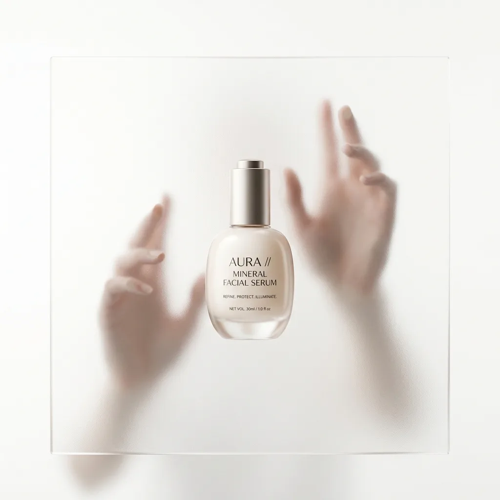

# Single product object

[← Back to the collection](../../README.md) · Category: [Product & Brand](../../gallery/product-brand.md) · Model: `Vinano Image Pro` · ID: `vn-00876`

<a href="https://vinano.ai?utm_source=github&utm_medium=readme&utm_campaign=awesome-image-video-prompts-updating&utm_content=prompt-page-image"></a>

<sub>Preview generated with <a href="https://vinano.ai?utm_source=github&utm_medium=readme&utm_campaign=awesome-image-video-prompts-updating&utm_content=prompt-page-caption">vinano.ai</a></sub>

## Prompt

```text
{
 "task": "photorealistic_product_visual",
 "input": {
 "reference_image": "USER_UPLOADED_IMAGE",
 "preserve_product_identity": true,
 "preserve_label_text": true,
 "preserve_object_shape": true,
 "preserve_centered_composition": true
 },
 "scene": {
 "environment": "high-key studio",
 "background": "pure white seamless",
 "negative_space": "very high",
 "depth_of_field": "layered depth strong subject isolation"
 },
 "subject": {
 "primary_object": "single product object",
 "position": "perfectly centered, floating",
 "orientation": "upright",
 "scale": "natural product scale",
 "clarity": "ultra-sharp, high micro-contrast"
 },
 "human_elements": {
 "hands": {
 "count": 2,
 "layering": "positioned behind a frosted glass surface",
 "visual_effect": "frosted glass diffusion, milky blur, softened edges",
 "transparency": "semi-opaque",
 "focus": "intentionally out of focus",
 "gesture": "slow, delicate, abstract reach",
 "interaction": "no contact the product"
 }
 },
 "optical_effects": {
 "frosted_glass": {
 "applied_to": "hands only",
 "blur_type": "diffusion blur",
 "edge_softness": "high",
 "light_scatter": "subtle bloom"
 }
 },
 "lighting": {
 "style": "soft diffused studio lighting",
 "direction": "frontal gentle top wash",
 "shadows": "extremely soft and minimal",
 "highlights": "clean, controlled highlights on the product only",
 "contrast": "low overall, high on product"
 },
 "materials_rendering": {
 "product_surface": "premium, realistic, tactile",
 "reflections": "clean and intentional",
 "imperfections": "none"
 },
 "aesthetic": {
 "mood": "ethereal, calm, refined",
 "style": "high-end editorial product photography",
 "visual_language": "minimal, airy, modern, poetic",
 "emotion": "care, purity, precision"
 },
 "camera": {
 "lens": "85mm",
 "aperture": "f/2.0",
 "angle": "eye-level",
 "camera_motion": "none"
 },
 "post_processing": {
 "retouching": "luxury commercial polish",
 "grain": "none",
 "color_grading": "clean whites subtle warmth on the product"
 },
 "output": {
 "resolution": "ultra_high_resolution",
 "focus_priority": "product only",
 "clarity_separation": "product razor sharp, background and hands diffused",
 "artifacts": "none"
 }
}

Maintain consistent colour harmony and crisp focus across the whole frame.
```

## Try it on vinano.ai

1. Copy the prompt above.
2. Open **[vinano.ai](https://vinano.ai?utm_source=github&utm_medium=readme&utm_campaign=awesome-image-video-prompts-updating&utm_content=prompt-page-try)**, paste it into the image generator and pick a model.
3. Swap any placeholders (brand, product, city, person…) for your own details, then generate.

More prompts like this: [Product & Brand gallery](../../gallery/product-brand.md) · [all categories](../../README.md#contents)
