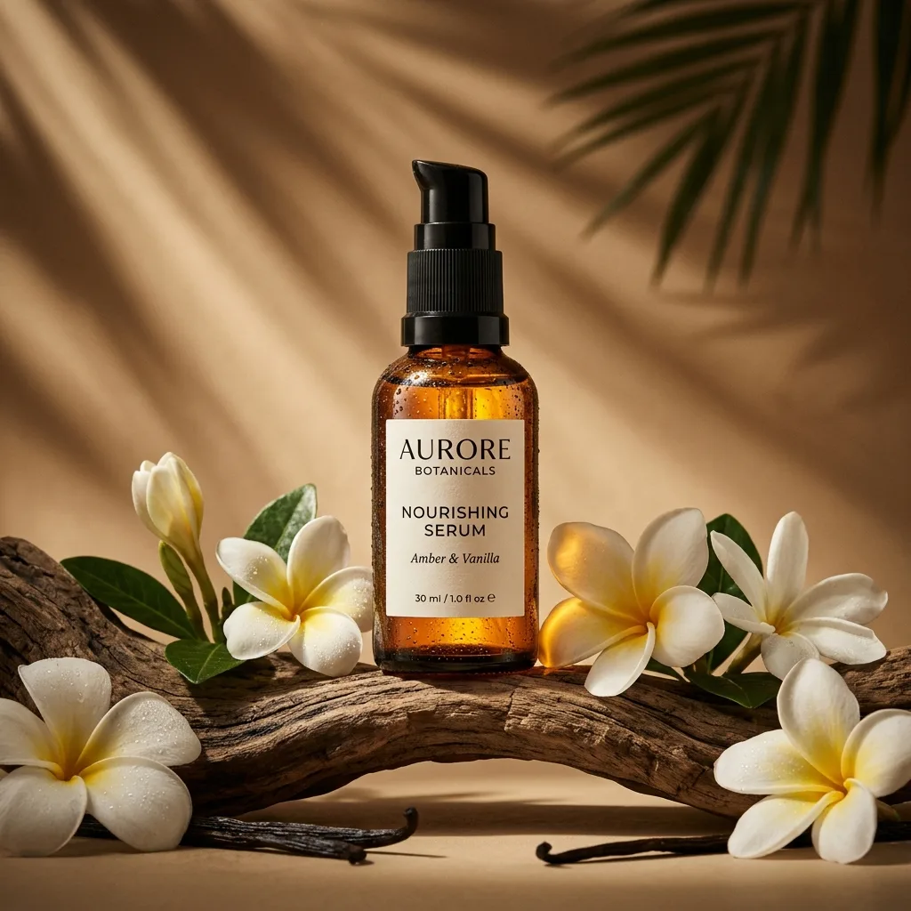

# - Ultra-cinematic luxury skincare product photography of a translucent

[← Back to the collection](../../README.md) · Category: [Product & Brand](../../gallery/product-brand.md) · Model: `Vinano Image Pro` · ID: `vn-00891`

<a href="https://vinano.ai?utm_source=github&utm_medium=readme&utm_campaign=awesome-image-video-prompts-updating&utm_content=prompt-page-image"></a>

<sub>Preview generated with <a href="https://vinano.ai?utm_source=github&utm_medium=readme&utm_campaign=awesome-image-video-prompts-updating&utm_content=prompt-page-caption">vinano.ai</a></sub>

## Prompt

```text
- Ultra-cinematic luxury skincare product photography of a translucent amber serum pump bottle standing upright at the center of the frame, perched on a curved piece of textured driftwood, featuring a refined minimalist label crisp black typography and fine condensation droplets on the glass; the bottle is framed by creamy white tropical flowers in full bloom and a single unopened bud, arranged symmetrically along the wood for sculptural balance, slender vanilla pods resting in the foreground; background is a warm, desert-toned studio environment sweeping shadow patterns cast across a soft sand-colored backdrop, creating a dramatic play of light and depth; lighting is high-contrast filmic, cinematic lighting a strong directional key light from the left producing glowing highlights through the amber liquid, sharp rim lighting along the glass edges, and deep shadow falloff for a moody, editorial look;

color palette is rich and sensual golden ambers, warm caramel, soft ivory, and deep earthy browns; composition is a centered hero shot a slight low-angle perspective and shallow depth of field, keeping the bottle razor-sharp while background elements dissolve into creamy bokeh; mood is elegant, mysterious, and high-fashion, evoking premium fragrance-inspired skincare advertising hyper-realistic textures, dramatic contrast, cinematic atmosphere, and 8K

ultra-high-definition realism.

Render with rich micro-detail while keeping the layout uncluttered and intentional.
```

## Try it on vinano.ai

1. Copy the prompt above.
2. Open **[vinano.ai](https://vinano.ai?utm_source=github&utm_medium=readme&utm_campaign=awesome-image-video-prompts-updating&utm_content=prompt-page-try)**, paste it into the image generator and pick a model.
3. Swap any placeholders (brand, product, city, person…) for your own details, then generate.

More prompts like this: [Product & Brand gallery](../../gallery/product-brand.md) · [all categories](../../README.md#contents)
