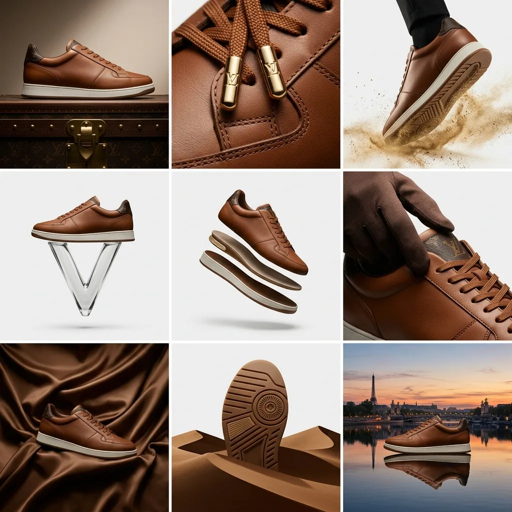

# Luxury Leather Sneaker / Trainer

[← Back to the collection](../../README.md) · Category: [Product & Brand](../../gallery/product-brand.md) · Model: `Vinano Image Pro` · ID: `vn-00907`

<a href="https://vinano.ai?utm_source=github&utm_medium=readme&utm_campaign=awesome-image-video-prompts-updating&utm_content=prompt-page-image"></a>

<sub>Preview generated with <a href="https://vinano.ai?utm_source=github&utm_medium=readme&utm_campaign=awesome-image-video-prompts-updating&utm_content=prompt-page-caption">vinano.ai</a></sub>

## Prompt

```text
{
 "campaign_metadata": {
 "brand_identity": "Louis Vuitton Malletier",
 "product_focus": "Luxury Leather Sneaker / Trainer",
 "aspect_ratio": "3:4",
 "aesthetic": "High-Fashion Editorial | Avant-Garde Luxury"
 },
 "visual_dna": {
 "materials": ["Full-grain calf leather", "Monogram Embossed Canvas", "Polished Gold Hardware"],
 "color_scheme": ["Cognac Brown", "Deep Obsidian", "Champagne Gold"],
 "lighting": "High-contrast Chiaroscuro | Soft-box Key Lighting"
 },
 "grid_layout_execution": {
 "row_1_heritage": {
 "cell_1_1": "Hero profile: Shoe resting on a vintage LV trunk, side-lit to show leather grain.",
 "cell_1_2": "Extreme macro: Focus on the gold-tone 'LV' lace aglets and precision stitching.",
 "cell_1_3": "Dynamic: Gold dust/particles swirling around the sole as it 'steps' into frame."
 },
 "row_2_innovation": {
 "cell_2_1": "refined minimalist: The shoe balanced atop an abstract, floating glass 'V' sculpture.",
 "cell_2_2": "Floating: Deconstructed view showing the sole and upper suspended in a void.",
 "cell_2_3": "Sensory: A gloved hand adjusting the tongue, emphasizing soft leather suppleness."
 },
 "row_3_surrealism": {
 "cell_3_1": "Color Palette: Monochromatic scene in LV 'Havane' brown liquid silk drapes.",
 "cell_3_2": "Abstraction: Symbolic representation of the rubber sole pattern as a geometric desert landscape.",
 "cell_3_3": "Fusion: The shoe walking on a mirror-still lake reflecting a Parisian sunset skyline."
 }
 }
}

Aim for an editorial, design-driven look with deliberate negative space.
```

## Try it on vinano.ai

1. Copy the prompt above.
2. Open **[vinano.ai](https://vinano.ai?utm_source=github&utm_medium=readme&utm_campaign=awesome-image-video-prompts-updating&utm_content=prompt-page-try)**, paste it into the image generator and pick a model.
3. Swap any placeholders (brand, product, city, person…) for your own details, then generate.

More prompts like this: [Product & Brand gallery](../../gallery/product-brand.md) · [all categories](../../README.md#contents)
