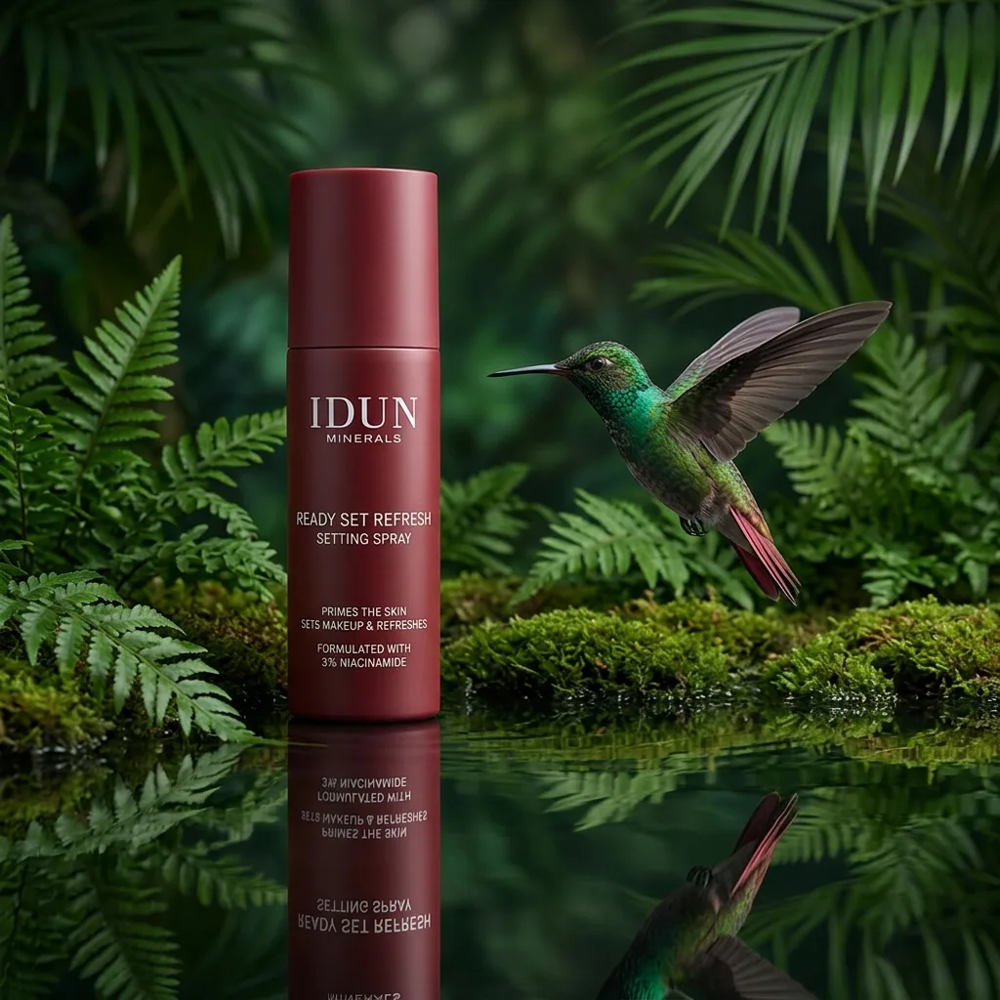

# Product & Brand prompt #973

[← Back to the collection](../../README.md) · Category: [Product & Brand](../../gallery/product-brand.md) · Model: `Vinano Image Pro` · ID: `vn-00973`

<a href="https://vinano.ai?utm_source=github&utm_medium=readme&utm_campaign=awesome-image-video-prompts-updating&utm_content=prompt-page-image"></a>

<sub>Preview generated with <a href="https://vinano.ai?utm_source=github&utm_medium=readme&utm_campaign=awesome-image-video-prompts-updating&utm_content=prompt-page-caption">vinano.ai</a></sub>

## Prompt

```text
{
 "subject": {
 "primary": "Cosmetic spray bottle",
 "secondary": "Hummingbird",
 "brand": "IDUN MINERALS",
 "product_name": "READY SET REFRESH"
 },
 "packaging": {
 "form_factor": "Cylindrical bottle",
 "component_parts": ["Main body",
 "Cap (flush body)"],
 "material_appearance": "Matte finish, likely plastic or coated metal",
 "condition": "Pristine, new",
 "reflections": "Vertical highlight on the left side, mirrored reflection in water below"
 },
 "label_design": {
 "type": "Direct print onto bottle",
 "layout_orientation": "Mixed (Horizontal brand/details, Vertical product name)",
 "typography": {
 "font_family": "Sans-serif",
 "casing": "All uppercase",
 "style": "Clean, refined minimalist",
 "alignment": "Left aligned relative to the vertical axis for product name, centered horizontally for brand"
 }
 },
 "text_visible": {
 "brand_header": ["IDUN",
 "MINERALS"],
 "body_vertical": ["READY SET REFRESH",
 "SETTING SPRAY"],
 "footer_details": ["PRIMES THE SKIN",
 "SETS MAKEUP & REFRESHES",
 "FORMULATED WITH",
 "3% NIACINAMIDE"],
 "reflection_text": "Inverted mirror image of all text visible on the water surface"
 },
 "colors": {
 "packaging_base": "Deep red / Burgundy",
 "text": "White",
 "foliage": ["Deep emerald green",
 "Forest green",
 "Moss green"],
 "hummingbird": ["Iridescent green (head/back)",
 "Dark grey/brown (wings)",
 "Reddish/pink (tail feathers)",
 "Black (beak)"],
 "water": "Dark, almost black reflections"
 },
 "materials": {
 "bottle": "Matte rigid material",
 "environment": ["Liquid water",
 "Moss",
 "Fern leaves",
 "Palm-like leaves"],
 "biological": "Feathers (bird)"
 },
 "human_elements": {
 "visible": false
 },
 "environment": {
 "setting": "Simulated rainforest or jungle floor",
 "foreground": "Still water surface",
 "midground": "Mossy bank, bottle placement",
 "background": "Dense tropical foliage"
 },
 "lighting": {
 "quality": "Soft, moody, atmospheric",
 "direction": "Side lighting from left (creating highlight on bottle)",
 "shadows": "Soft shadows in the foliage, dark water providing high contrast reflection",
 "highlights": "specular highlight on hummingbird head, diffuse highlight on bottle curve"
 },
 "camera": {
 "angle": "Eye-level water surface",
 "framing": "Vertical portrait",
 "focus": "Sharp focus on bottle and hummingbird",
 "depth_of_field": "Shallow (background leaves are blurred/bokeh)",
 "composition": "Rule of thirds (bottle on left third line, bird entering from right)"
 },
 "style": {
 "category": "Product photography",
 "theme": "Nature, Organic, Eco-luxury",
 "mood": "Serene, fresh, premium"
 }
}

Render with rich micro-detail while keeping the layout uncluttered and intentional.
```

## Try it on vinano.ai

1. Copy the prompt above.
2. Open **[vinano.ai](https://vinano.ai?utm_source=github&utm_medium=readme&utm_campaign=awesome-image-video-prompts-updating&utm_content=prompt-page-try)**, paste it into the image generator and pick a model.
3. Swap any placeholders (brand, product, city, person…) for your own details, then generate.

More prompts like this: [Product & Brand gallery](../../gallery/product-brand.md) · [all categories](../../README.md#contents)
