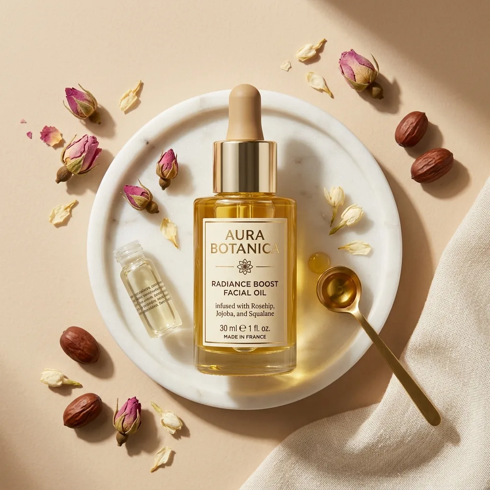

# Top-down flat lay product photo

[← Back to the collection](../../README.md) · Category: [Product & Brand](../../gallery/product-brand.md) · Model: `Vinano Image Pro` · ID: `vn-00979`

<a href="https://vinano.ai?utm_source=github&utm_medium=readme&utm_campaign=awesome-image-video-prompts-updating&utm_content=prompt-page-image"></a>

<sub>Preview generated with <a href="https://vinano.ai?utm_source=github&utm_medium=readme&utm_campaign=awesome-image-video-prompts-updating&utm_content=prompt-page-caption">vinano.ai</a></sub>

## Prompt

```text
Create top-down flat lay product photo. Use the uploaded product as the main object, centered. Analyze the product type from the photo and automatically choose matching props/ingredients for an aesthetic flat lay around it (minimal, premium, on-brand). Preserve exact geometry, size, colors, label design, and all text on the product (no changes). Warm beige seamless background, soft directional sunlight, crisp realistic shadow.
Ultra-realistic macro product photography, 100mm lens look, f/8, sharp focus, crisp composition, no extra text, 8k, format 2:3.

Preserve realistic proportions and depth for a confident, professional finish.
```

## Try it on vinano.ai

1. Copy the prompt above.
2. Open **[vinano.ai](https://vinano.ai?utm_source=github&utm_medium=readme&utm_campaign=awesome-image-video-prompts-updating&utm_content=prompt-page-try)**, paste it into the image generator and pick a model.
3. Swap any placeholders (brand, product, city, person…) for your own details, then generate.

More prompts like this: [Product & Brand gallery](../../gallery/product-brand.md) · [all categories](../../README.md#contents)
